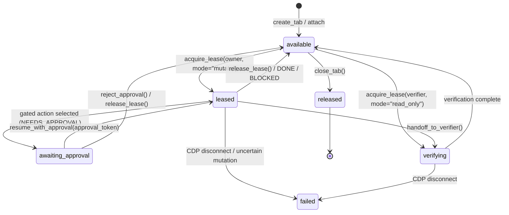
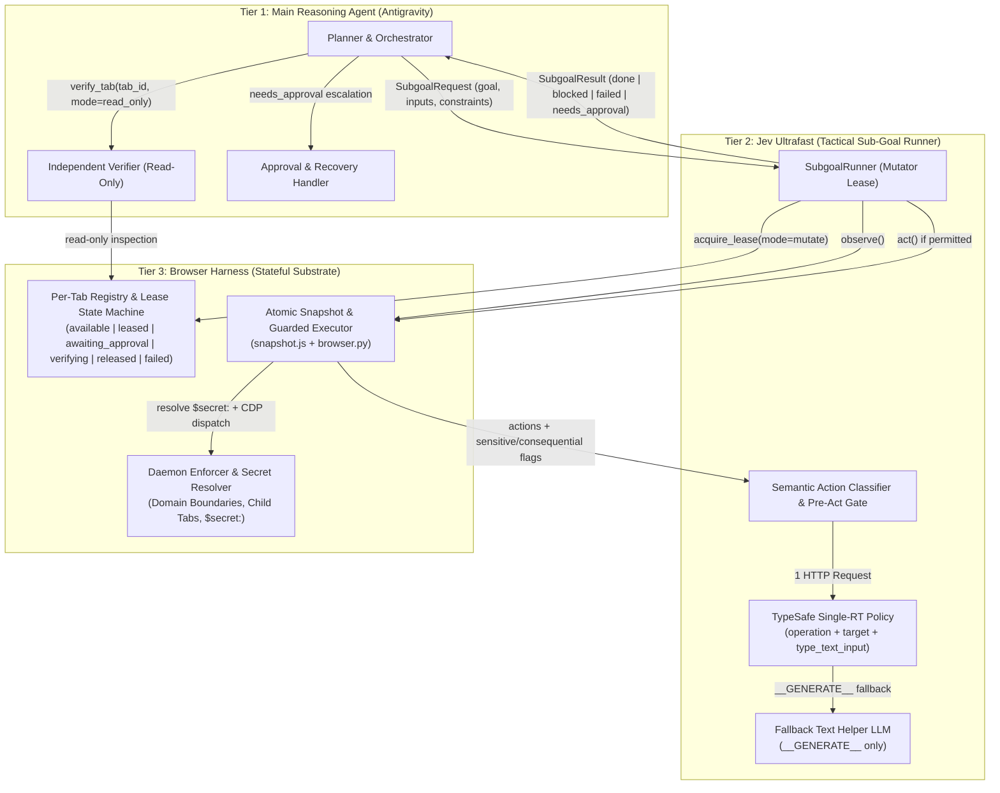

# Jev Ultrafast + Browser Harness as Antigravity's Browser Execution Subsystem

* **Author:** Antigravity & EGM Goldfish Review Panel
* **Date:** 2026-10-29

## Overview

This proposal repositions [`jev-ultrafast`](file:///c:/Users/Albe/Documents/CLI-Project/jev-ultrafast/jev_ultrafast/agent.py) and `browser-harness` from a standalone single-goal demo into the reusable browser execution subsystem for a larger autonomous agent system running inside Antigravity.

Instead of asking a slow frontier model to drive every click or asking a small tactical policy to plan open-ended workflows, the architecture splits browser autonomy into three explicit tiers:
1. **Main Reasoning Agent (Antigravity)**: Owns multi-step task decomposition, cross-tool orchestration, supplying structured `inputs` (including opaque `$secret:<id>` references), setting deterministic and policy `constraints`, handling `needs_approval` escalations, recovering from `blocked` states, and coordinating independent verification on claimed outcomes.
2. **Jev Ultrafast (Tactical Browser Loop)**: Executes bounded navigation and interaction sub-goals (3–15 UI steps, e.g., `"Find the billing settings for this account"`) over a leased tab using an atomic indexed DOM snapshot and a single TypeSafe network round-trip per step (`CLICK`, `TYPE_TEXT`, `SELECT`, `SCROLL_UP`, `SCROLL_DOWN`, `WAIT`, `DONE`, `BLOCKED`, `NEEDS_APPROVAL`). When caller-supplied `inputs` are present, `TYPE_TEXT` selects both `type_text_target` and `type_text_input` in the same TypeSafe request without calling a secondary text LLM on the fast path.
3. **Browser Harness (Session, Tab, and Enforcement Substrate)**: Manages persistent Chrome/CDP connections, a per-tab registry with explicit lifecycle states (`available`, `leased`, `awaiting_approval`, `verifying`, `released`, `failed`) and exclusive mutation lease tokens, child-tab tracking, opaque secret resolution at input dispatch time, and low-level deterministic safety enforcement below the model.

## Analysis

A six-lens Goldfish review (`egm-design`, `egm-codebase-details`, `egm-zoom-out`, `egm-comprehension`, `egm-implementation-readiness`, `egm-structural`) audited the hypothesis against the [`jev-ultrafast`](file:///c:/Users/Albe/Documents/CLI-Project/jev-ultrafast/jev_ultrafast) codebase and the installed `browser-harness==0.1.13` package. All five architectural tensions surfaced by the reviewers are resolved below:

### 1. Consequence-Based Safety Enforcement vs. HTTP-Method Proxies and IPC Deadlocks
* **The Challenge**:
  1. **HTTP Verbs Are Unreliable Proxies for Consequence**: Modern web applications routinely use `POST` for read-only RPCs (`POST /graphql`, Next.js Server Actions, Google's `batchexecute` RPCs, search/autocomplete), while poorly designed systems can trigger side effects via `GET` links or client-side state transitions. Treating HTTP methods alone as the definition of read-only behavior either breaks standard SPAs or misses real mutations.
  2. **Protocol Deadlock in `browser-harness`**: `browser_harness/helpers.py` uses synchronous short-lived per-command IPC sockets (5-second timeout), while `browser_harness/daemon.py` stores CDP events in a single global 500-event ring buffer (`deque(maxlen=500)`) drained destructively via `drain_events()`. Pausing requests via `Fetch.requestPaused` for client-side inspection over IPC will deadlock or drop paused requests whenever the 500-event buffer overflows or another tool reads events.
* **Resolved Architecture**:
  - **Do not use HTTP method alone as the safety boundary.** Instead, combine five defense-in-depth mechanisms:
    1. **Deterministic Domain & Navigation Boundaries**: Enforce allowed/denied domain rules and cross-origin navigation policies asynchronously inside the `browser-harness` daemon event loop (`Page.frameRequestedNavigation`, `Target.targetCreated`, link/form origin checks).
    2. **Semantic Action Classification & Explicit UI Gating**: Classify interactive controls in [`snapshot.js`](file:///c:/Users/Albe/Documents/CLI-Project/jev-ultrafast/jev_ultrafast/snapshot.js) by structural and semantic signals (`<button type="submit">`, `<form>`, ARIA roles/labels/descriptions indicating purchase, payment, deletion, removal, sending, account modification, upgrade/cancellation, or credential entry).
    3. **Pre-Execution `needs_approval` Gate**: When Jev selects an action on a control classified as consequential, destructive, form-submitting (under a no-submit constraint), or credential-bearing, halt *before* [`Browser.act()`](file:///c:/Users/Albe/Documents/CLI-Project/jev-ultrafast/jev_ultrafast/browser.py#L100-L107), transition the tab state to `awaiting_approval`, persist the pending action on the tab record, and return `status: "needs_approval"`.
    4. **Human Approval Escalation**: Require explicit human approval (via an approval token bound to the pending action and tab fingerprint) before executing credentials, purchases, deletion, sending, account changes, or other high-impact mutations.
    5. **Secondary Network Interception**: Use daemon-side CDP network interception (`Fetch` / `Network`) as a secondary defense-in-depth signal and boundary check (e.g., blocking disallowed third-party domains or unapproved file uploads/downloads) rather than the sole definition of read-only behavior.

### 2. Orthogonal Speculative Heads for Structured `TYPE_TEXT`
* **The Challenge**: Modeling `TYPE_TEXT` with caller-supplied `inputs` by flattening `(element_index, input_key)` into a single Cartesian choice head like `SELECT` (`element_index:option_index` in [`model.py`](file:///c:/Users/Albe/Documents/CLI-Project/jev-ultrafast/jev_ultrafast/model.py#L74-L77)) produces $N \times K$ choices across $N$ textboxes and $K$ input keys, inflating prompt tokens on every step and risking failures in [`validate_choice`](file:///c:/Users/Albe/Documents/CLI-Project/jev-ultrafast/jev_ultrafast/model.py#L30-L45) (`abs(sum(probabilities.values()) - 1) < 0.02`).
* **Resolved Architecture**:
  - Preserve **two orthogonal speculative heads** in the same single TypeSafe `/v1/systemone` request:
    - `type_text_target`: selects the target editable element index (`"1"`, `"2"`, ...).
    - `type_text_input`: selects the input source among caller-supplied keys (`"input:account_name"`, ...) plus `"__GENERATE__"` (fallback to the secondary text helper LLM only when free-form composition or value transformation is genuinely required).
  - Both heads resolve in **one network round-trip** with $O(N + K)$ options instead of $O(N \times K)$, and `field_text()` is bypassed completely whenever an `input:<key>` is selected.

### 3. Per-Tab Registry, Explicit Lifecycle States, and Single-Mutator Lease Authority
* **The Challenge**:
  1. `browser_harness/daemon.py` currently stores singleton fields across the entire daemon (`self.session`, `self.target_id`, `self.dialog`) and injects a `'🐴 '` prefix into `document.title` on `Page.loadEventFired`—mutating `document.title` mid-step and causing spurious `StalePage` errors in [`snapshot.js`](file:///c:/Users/Albe/Documents/CLI-Project/jev-ultrafast/jev_ultrafast/snapshot.js#L97-L98).
  2. [`Browser.close()`](file:///c:/Users/Albe/Documents/CLI-Project/jev-ultrafast/jev_ultrafast/browser.py#L109-L113) unconditionally closes the tab when `Agent` exits.
  3. Clicking links with `target="_blank"` or `window.open()` opens a new CDP target while leaving the original tab unchanged (`page_changed=False`), causing [`agent.py`](file:///c:/Users/Albe/Documents/CLI-Project/jev-ultrafast/jev_ultrafast/agent.py#L153-L158) to click the popup trigger three times and halt with `status = "blocked"`.
* **Resolved Architecture**:
  - Replace singleton daemon globals with a **Per-Tab Registry** indexed by `tab_id` (`targetId`) and grouped under `session_id`.
  - Enforce an explicit **Tab Lifecycle State Machine**:
    - `available`: Tab is open and idle; can be leased for execution or inspected.
    - `leased`: An execution actor holds the exclusive `lease_token` with mutation authority (`act`, `navigate`). Concurrent mutation requests from other actors are rejected.
    - `awaiting_approval`: Execution is paused prior to a gated action; holds the pending action and page fingerprint until resumed with an `approval_token` or aborted/released.
    - `verifying`: Tab is held for post-step independent verification; mutation commands are blocked while independent verifier tools exercise **read-only observation access** (`observe`, DOM query, URL/network inspection, screenshot).
    - `released`: Tab lease has been cleanly relinquished by the sub-goal runner and is ready for the next sub-goal or cleanup.
    - `failed`: Tab encountered an unrecoverable protocol error, crash, or uncertain mutation interruption (`UNCERTAIN_MUTATION_STATE`) and requires explicit inspection or reset before reuse.
  - Track child targets (`openerId == current_tab_id`) on `Target.targetCreated` so new-tab workflows register `forked_tab_ids` under the same `session_id` and either transition active focus (`follow_new_tabs="auto"`) or record the child tab creation as progress.
  - Disable `TAB_MARKER_JS` title mutation on leased programmatic tabs (and normalize `document.title` in `snapshot.js`).

### 4. Observable Masked Sensitive Fields and Opaque `$secret:<id>` Resolution
* **The Challenge**: Line 9 of [`snapshot.js`](file:///c:/Users/Albe/Documents/CLI-Project/jev-ultrafast/jev_ultrafast/snapshot.js#L9) sets `const safe = e => !['password','file','hidden'].includes(e.type);`. Because password and authentication fields are stripped from `actions`, Jev cannot detect login or re-authentication prompts on billing/account pages, nor can it escalate with `status: "needs_approval"`. Conversely, exposing raw secrets in planner prompts, model requests, traces, or screenshots violates credential isolation.
* **Resolved Architecture**:
  - **Observable Masked Metadata**: Expose password and authentication inputs in [`snapshot.js`](file:///c:/Users/Albe/Documents/CLI-Project/jev-ultrafast/jev_ultrafast/snapshot.js) with masked metadata:
    - `sensitive: true`
    - `value_required: true` (when empty/unfilled)
    - `value: ""` or `"[MASKED]"` (never the actual character string or length in `actions`, `pageKey()`, or `guard()`)
  - **Escalation on Unapproved Credentials**: When Jev encounters a required credential field, it can select `NEEDS_APPROVAL` (or select `TYPE_TEXT` on the `sensitive: true` target, which the pre-act gate intercepts) to return `status: "needs_approval"`, `reason_code: "CREDENTIAL_ENTRY"`.
  - **Opaque `$secret:<id>` Resolution at Lowest Execution Layer**:
    - Callers pass opaque references in `inputs`, e.g., `inputs={"password": "$secret:corp_billing_pw"}`.
    - Neither the main reasoning agent, TypeSafe, the fallback text LLM, the action trace, nor reviewer logs ever see the plaintext secret.
    - Only when execution is authorized at the lowest trusted execution layer (`Browser.act` / `browser-harness`) is `$secret:<id>` dereferenced from the server-side secret store and dispatched directly via CDP `Input.insertText`, with post-input screenshot capture suppressed or redacted while the field is focused.

### 5. Tactical DOM Upgrades & Independent Verification Without Context Bloat
* **The Challenge**:
  1. **Nested Scroll Containers & Open Shadow DOM**: `snapshot.js` only offers scroll actions when `document.documentElement.scrollHeight > innerHeight` and scrolls at hardcoded coordinates `x=550, y=650`, failing on modal dialogs and split-pane SaaS apps. It also skips open `shadowRoot`s and truncates at 250 actions without signaling truncation to the model.
  2. **Independent Verification vs. Context Bloat**: Returning 250 elements and screenshots into Antigravity's context window on every step bloats tokens, while verifying solely against `snapshot.js`'s distilled output shares `snapshot.js`'s blind spots.
* **Resolved Architecture**:
  - **DOM & Execution Upgrades**: Detect active scrollable containers (dialogs and `overflow-y: auto/scroll` regions) in `snapshot.js` and scroll at their bounding-box center; recursively traverse open `shadowRoot`s; expose `omitted_actions_count`; and dispatch bubbling `input`/`change` events after `Input.insertText` using browser-detected OS modifier keys.
  - **Read-Only Verifier Access on `verifying` Tabs**: Return a compact structured `SubgoalResult` to the main reasoning agent while transitioning the tab to `verifying` (or `available`) so an independent verifier tool can inspect live DOM predicates, full text beyond 6,000 characters, URL/route parameters, and network status codes with read-only access.

## Goals vs. Non-Goals

* **In-Scope Goals:**
  - Establish the three-tier responsibility boundary between Antigravity (planning, structured inputs, approval handling, independent verification), Jev Ultrafast (bounded tactical loop), and Browser Harness (per-tab state machine, lease locking, secret resolution, deterministic boundaries).
  - Implement a per-tab registry in `browser-harness` with explicit lifecycle states (`available`, `leased`, `awaiting_approval`, `verifying`, `released`, `failed`), single-mutator lease enforcement, and read-only verifier access.
  - Upgrade `TYPE_TEXT` to use orthogonal `type_text_target` and `type_text_input` heads in a single TypeSafe request, eliminating secondary LLM calls when caller-supplied `inputs` match.
  - Expose authentication/password fields as masked metadata (`sensitive: true`, `value_required: true`) and resolve opaque `$secret:<id>` references strictly at the lowest execution layer outside all model contexts, traces, logs, and screenshots.
  - Enforce safety through consequence-based defense in depth: deterministic domain/navigation boundaries, semantic UI action classification, form submission and consequential action gating, human approval gates (`status: "needs_approval"`), and secondary network interception.
  - Standardize the `SubgoalRequest` and `SubgoalResult` contracts (`done | blocked | failed | needs_approval`, structured `reason_code`, `action_trace`, `constraint_events`, `pending_approval`, `claimed_evidence`, and conditional screenshots).
  - Upgrade [`snapshot.js`](file:///c:/Users/Albe/Documents/CLI-Project/jev-ultrafast/jev_ultrafast/snapshot.js) and [`browser.py`](file:///c:/Users/Albe/Documents/CLI-Project/jev-ultrafast/jev_ultrafast/browser.py) for nested scroll containers, open Shadow DOM traversal, child-tab (`openerId`) tracking, and framework-safe text entry.
  - Preserve backwards compatibility for the standalone `Agent(url, goals)` API and offline test suite.

* **Out-of-Scope Non-Goals:**
  - Using HTTP methods (`POST`/`GET`) alone as the sole definition of read-only or safe behavior.
  - Flattening `element × input_key` into a Cartesian choice head.
  - Placing plaintext secret values into planner prompts, TypeSafe requests, text helper calls, traces, logs, or screenshots.
  - Allowing concurrent mutation authority on the same tab by multiple agents.
  - Consuming screenshots inside the fast-path TypeSafe decision loop or allowing models to emit selectors, coordinates, or executable code.
  - Retrying browser mutations whose execution outcome was uncertain.

## Alternatives Weighed

1. **Use HTTP Method Blocking (`POST`/`PUT`/`PATCH`/`DELETE`) Alone as the Read-Only Safety Boundary**:
   - *Rejected*: Modern SPAs use `POST` for read-only GraphQL/RPC queries, while poorly designed apps can mutate state via `GET` or client-side actions. Safety requires combining deterministic domain/navigation boundaries, semantic UI classification, form/consequential action gating, human approval gates, and secondary network interception.
2. **Encode `TYPE_TEXT` as a Flattened Cartesian Product (`element_index:input_key`) in `type_text_target`**:
   - *Rejected*: Creates $O(N \times K)$ candidate choices in a single head, inflating prompt tokens and degrading TypeSafe probability calibration. Preserving orthogonal `type_text_target` and `type_text_input` heads in the same request achieves single-round-trip selection in $O(N + K)$ choices.
3. **Keep `browser-harness` Singleton Session Globals or Allow Uncoordinated Multi-Agent Tab Access**:
   - *Rejected*: Causes race conditions, corrupted UI state, and spurious `StalePage` exceptions from title-marker collisions. Explicit per-tab lifecycle states (`available`, `leased`, `awaiting_approval`, `verifying`, `released`, `failed`) with single-mutator lease tokens and read-only verifier access prevent concurrent corruption.
4. **Either Hide Password Fields Completely (`safe()` Filter) or Pass Raw Secrets Through Planner/Model Prompts**:
   - *Rejected*: Hiding password fields makes Jev blind to authentication walls (`needs_approval`), while passing plaintext secrets in prompts or traces leaks credentials. Exposing masked field metadata (`sensitive: true`, `value_required: true`) paired with lowest-layer `$secret:<id>` resolution satisfies both observability and secret isolation.
5. **Keep `Agent` as a Stateless One-Shot Runner**:
   - *Rejected*: Destroys tab state on completion, preventing pause/resume approval flows, multi-step sub-goal chaining, and independent live-tab verification.

## Key Decisions & Staging for Next Steps

1. **Phase 1 — Per-Tab Registry & Lease State Machine (`browser-harness` + `browser.py`)**:
   - Implement tab lifecycle states (`available`, `leased`, `awaiting_approval`, `verifying`, `released`, `failed`), single-mutator lease tokens, read-only verifier leases, child-tab (`openerId`) tracking, and title-marker normalization.
2. **Phase 2 — Orthogonal `TYPE_TEXT` Heads & Opaque `$secret:<id>` Resolution (`model.py` + `agent.py` + `snapshot.js`)**:
   - Add `type_text_input` alongside `type_text_target` in the single TypeSafe request, expose masked sensitive fields (`sensitive: true`, `value_required: true`) in `snapshot.js`, and resolve `$secret:<id>` strictly inside the low-level input dispatcher.
3. **Phase 3 — Consequence-Based Policy Engine & `needs_approval` Lifecycle (`snapshot.js` + `browser.py` + `agent.py`)**:
   - Combine daemon-level domain/navigation boundaries, semantic UI classification for form submission and consequential actions, pre-act pause (`awaiting_approval`), approval-token resume, and secondary network interception.
4. **Phase 4 — Standardized `SubgoalResult` Contract & Read-Only Independent Verifier**:
   - Emit structured `done | blocked | failed | needs_approval` results with `reason_code`, `action_trace`, `constraint_events`, and `claimed_evidence`, plus read-only verifier primitives against `verifying` tabs.
5. **Phase 5 — Tactical Web Compatibility (`snapshot.js` + `browser.py`)**:
   - Add nested scroll container detection, open Shadow DOM traversal, and framework-compatible input events while keeping `Agent(url, goals)` backwards-compatible.
