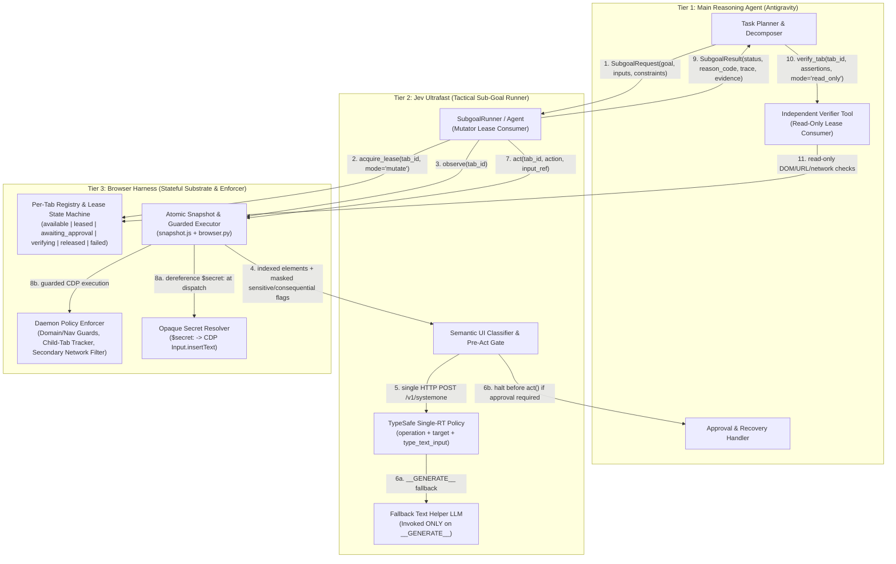
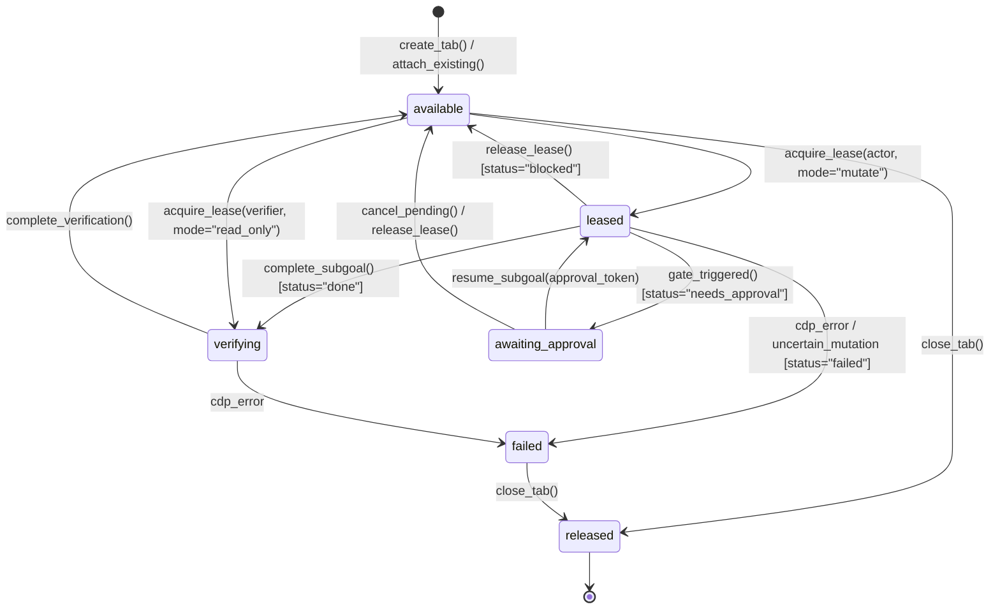

# Jev Ultrafast + Browser Harness as Antigravity's Browser Execution Subsystem

*   **Author:** Antigravity & EGM Goldfish Review Panel
*   **Status:** Draft
*   **Date:** 2026-10-29

--------------------------------------------------------------------------------

## Overview

This design transforms [`jev-ultrafast`](file:///c:/Users/Albe/Documents/CLI-Project/jev-ultrafast/jev_ultrafast/agent.py) and `browser-harness` from a standalone, single-goal demo into the reusable browser execution subsystem for a multi-agent system running inside Antigravity.

The architecture separates web autonomy into three distinct tiers:
1.  **Main Reasoning Agent (Antigravity)**: Owns long-horizon task planning, goal decomposition, cross-tool orchestration, structured input supply (including opaque `$secret:<id>` references), policy configuration, user approval handling, recovery from blocked states, and independent outcome verification.
2.  **Jev Ultrafast (Tactical Sub-Goal Runner)**: Executes bounded navigation and interaction sub-goals (typically 3–15 UI actions, such as finding an account's billing settings or applying search filters) over a leased tab. Each step reads an atomic indexed DOM snapshot and resolves both the operation and its parameters in a single TypeSafe request (`CLICK`, `TYPE_TEXT`, `SELECT`, `SCROLL_UP`, `SCROLL_DOWN`, `WAIT`, `DONE`, `BLOCKED`, `NEEDS_APPROVAL`).
3.  **Browser Harness (Stateful Session, Tab, and Enforcement Substrate)**: Manages persistent Chrome DevTools Protocol (CDP) connections, a per-tab registry with explicit lifecycle states (`available`, `leased`, `awaiting_approval`, `verifying`, `released`, `failed`), single-mutator lease tokens, child-tab tracking, lowest-layer secret resolution, and deterministic navigation/policy enforcement below the model.

## The Problem

Today, [`jev-ultrafast`](file:///c:/Users/Albe/Documents/CLI-Project/jev-ultrafast/jev_ultrafast) proves that an indexed DOM action space paired with a single-round-trip TypeSafe policy can drive a browser loop with sub-200ms decision latency. However, five structural limitations prevent it from serving as a dependable browser subsystem inside Antigravity:

1.  **Ephemeral, One-Shot Tab Lifecycle**: [`Browser.__init__`](file:///c:/Users/Albe/Documents/CLI-Project/jev-ultrafast/jev_ultrafast/browser.py#L21-L34) and [`Agent.__init__`](file:///c:/Users/Albe/Documents/CLI-Project/jev-ultrafast/jev_ultrafast/agent.py#L13-L45) create a new tab on startup, run a single natural-language goal until `DONE` or `BLOCKED`, and unconditionally close the tab on exit. Meanwhile, `browser-harness` (`0.1.13`) stores singleton session state (`self.session`, `self.target_id`, `self.dialog`) and mutates `document.title` with a `'🐴 '` marker on load events—causing spurious `StalePage` exceptions in [`snapshot.js`](file:///c:/Users/Albe/Documents/CLI-Project/jev-ultrafast/jev_ultrafast/snapshot.js#L97-L98). The main reasoning agent cannot issue sequential sub-goals on the same tab, pause and resume around user approvals, or hand a live tab to an independent verifier without races or state loss.
2.  **Unnecessary Secondary LLM Calls and Secret Exposure Risk on `TYPE_TEXT`**: Whenever Jev selects `TYPE_TEXT`, [`agent.py`](file:///c:/Users/Albe/Documents/CLI-Project/jev-ultrafast/jev_ultrafast/agent.py#L106-L115) invokes a secondary text LLM (`field_text`) to infer the string to type from the raw goal and page text. When the upstream reasoning agent already possesses structured inputs, calling a secondary LLM adds 350–600ms of latency and introduces failure modes. Worse, [`snapshot.js`](file:///c:/Users/Albe/Documents/CLI-Project/jev-ultrafast/jev_ultrafast/snapshot.js#L9) strips `input[type="password"]` completely (`safe = e => !['password','file','hidden'].includes(e.type)`), making Jev blind to authentication prompts while offering no mechanism to inject credentials without exposing secrets to model contexts.
3.  **Lack of Consequence-Based Safety Boundaries**: Passing constraints like `"do not submit changes"` or `"do not leave this domain"` only in prompt text provides no deterministic guarantee against unintended form submissions, destructive clicks, or cross-domain navigations. At the same time, naive network rules that block all HTTP `POST` requests break modern single-page applications (GraphQL, Next.js Server Actions, Google RPCs) that use `POST` for read-only views.
4.  **Unverified `DONE` Status and Insufficient Diagnostic Evidence**: TypeSafe choosing `DONE` means only that the tactical policy believes the goal is satisfied, not that the outcome actually succeeded. Furthermore, when Jev halts with `BLOCKED`, it returns no structured reason code or constraint telemetry for the main reasoning agent to distinguish between a missing input, an authentication wall, a policy gate, a popup tab, or an unsupported UI widget.
5.  **Tactical DOM Blind Spots on Real Web Applications**: [`snapshot.js`](file:///c:/Users/Albe/Documents/CLI-Project/jev-ultrafast/jev_ultrafast/snapshot.js) only scrolls the root document at fixed coordinates (`x=550, y=650`), ignores open Shadow DOM roots, silently truncates controls after index 250 without signaling truncation, and does not track child tabs opened via `target="_blank"` or `window.open()`—causing Jev to triple-click popup links and fail on standard SaaS settings and billing interfaces.

## Goals

*   **Enforce a Three-Tier Responsibility Boundary**: Keep strategic planning, parameter supply, approval escalation, and independent verification in Antigravity; keep fast multi-step tactical UI execution in Jev Ultrafast; and keep tab lifecycle, lease locking, secret dereferencing, and low-level policy enforcement in Browser Harness.
*   **Provide Persistent Session and Tab Handles with Explicit Ownership**: Manage tabs through an explicit state machine (`available`, `leased`, `awaiting_approval`, `verifying`, `released`, `failed`) where at most one actor holds mutation authority (`leased`) at a time and independent verifiers receive read-only observation access (`verifying`).
*   **Eliminate Secondary LLM Calls for Known Inputs via Orthogonal `TYPE_TEXT` Heads**: Select both `type_text_target` (the editable element) and `type_text_input` (caller-supplied `input:<key>` vs. `__GENERATE__`) in a single TypeSafe round-trip with $O(N + K)$ choices, invoking the fallback text LLM only when `__GENERATE__` is selected.
*   **Isolate Secrets While Keeping Sensitive Fields Observable**: Expose password and authentication fields in DOM snapshots as masked metadata (`sensitive: true`, `value_required: true`) so Jev can detect credential prompts and return `needs_approval`, while resolving actual values via opaque `$secret:<id>` references strictly inside the lowest execution layer outside prompts, traces, logs, and screenshots.
*   **Enforce Consequence-Based Safety and Human Approval Gates**: Combine deterministic domain/navigation boundaries, semantic UI classification of form submissions and consequential controls, pre-execution `needs_approval` pausing (`awaiting_approval`), human approval tokens, and secondary daemon-side network checks without relying on HTTP verbs alone.
*   **Deliver Evidence-Rich Results and Read-Only Verification Primitives**: Return a structured `SubgoalResult` (`done | blocked | failed | needs_approval`, `reason_code`, `action_trace`, `constraint_events`, `pending_approval`, `claimed_evidence`, and risk-triggered screenshots) and allow independent verifier tools to inspect live `verifying` tabs without mutating UI state.
*   **Upgrade Tactical Web Compatibility While Preserving Speed and Backwards Compatibility**: Support nested scrollable containers, open Shadow DOM traversal, child-tab (`openerId`) tracking, and framework-compatible input events while keeping the existing `Agent(url, goals)` API and offline test suite working.

## Non-Goals

*   **Using HTTP Methods Alone as the Safety Boundary**: The subsystem will not define read-only mode solely by blocking `POST`/`PUT`/`PATCH`/`DELETE` requests or assuming `GET` requests are side-effect-free.
*   **Cartesian Flattening of `TYPE_TEXT` Choices**: The policy will not flatten `element_index × input_key` into a single combinatorial choice head.
*   **Exposing Plaintext Secrets Above the Execution Substrate**: Plaintext credential values must never appear in planner prompts, TypeSafe payloads, text helper calls, action traces, reviewer logs, or unredacted screenshots.
*   **Concurrent Multi-Agent Mutation of the Same Tab**: Two agents or tools may never hold simultaneous mutation authority on the same `tab_id`.
*   **Long-Horizon Planning or Multimodal Fast-Path Loops inside Jev**: Jev Ultrafast will not decompose multi-stage workflows on its own or consume screenshots inside its per-step TypeSafe request loop.
*   **Model-Generated Selectors or Code Execution**: Models may only select from code-observed element indices and structured input keys, never CSS/XPath selectors, coordinates, or JavaScript.
*   **Automatic Retries of Uncertain Browser Mutations**: Any interrupted mutation whose side effect is uncertain transitions the tab to `failed` (`UNCERTAIN_MUTATION_STATE`) for inspection rather than retrying automatically.

## Open Questions

*   *None remaining from brainstorming; all architectural boundaries and Goldfish objections were resolved prior to drafting.*

## Critical User Journeys (CUJs)

### CUJ 1: Bounded Read-Only Sub-Goal with Structured Inputs and Independent Verification

*   **Given**: Antigravity holds an authenticated browser session (`session_id="sess_1"`, `tab_id="tab_1"` in state `available`) on an enterprise dashboard and wants to locate the billing settings for account `"Acme Corp"` without submitting changes or leaving the domain.
*   **When**: Antigravity invokes `run_subgoal` with `goal="Find the billing settings for this account"`, `inputs={"account_name": "Acme Corp"}`, `constraints=SubgoalConstraints(allowed_domains=["app.example.com"], mode="read_only")`, and `expected_result={"type": "location_or_blocked"}`.
*   **Then**:
    1.  `SubgoalRunner` acquires an exclusive mutation lease (`tab_1` transitions `available -> leased`).
    2.  When typing `"Acme Corp"` into the account switcher combobox, TypeSafe selects `operation="TYPE_TEXT"`, `type_text_target="2"`, and `type_text_input="input:account_name"` in one request (`0` calls to the secondary text LLM).
    3.  Jev navigates to `/settings/billing` (including scrolling inside a nested settings container and traversing open Shadow DOM controls), chooses `DONE`, and transitions `tab_1` to `verifying`.
    4.  `SubgoalRunner` returns `SubgoalResult(status="done", reason_code="GOAL_SATISFIED", final_url="https://app.example.com/settings/billing", ...)`.
    5.  Antigravity invokes the read-only verifier on `tab_1`, which independently confirms the URL, heading text, and matched account context before releasing `tab_1` back to `available`.

### CUJ 2: Consequential Action Interception and `needs_approval` Pause/Resume

*   **Given**: Antigravity issues a sub-goal on `tab_1` where advancing the workflow requires either entering a password into a re-authentication prompt (`sensitive: true`, `value_required: true`) or clicking a consequential button (`"Update Billing Address"` / `"Delete Payment Method"`).
*   **When**: `snapshot.js` exposes the password field with masked metadata (`sensitive: true`, `value_required: true`, `value: ""`) or flags the submit button as consequential, and Jev selects that target (or chooses `NEEDS_APPROVAL`).
*   **Then**:
    1.  The pre-execution gate halts **before** `Browser.act()` dispatches any CDP mouse or key event.
    2.  `tab_1` transitions from `leased` to `awaiting_approval`, storing the pending action, target node guard, and page fingerprint.
    3.  `SubgoalRunner` returns `SubgoalResult(status="needs_approval", reason_code="CREDENTIAL_ENTRY" | "DESTRUCTIVE_ACTION", pending_approval={...})`.
    4.  Once the user or policy handler grants approval (providing `approval_token` and, if applicable, an opaque `inputs={"password": "$secret:corp_pw"}` reference), Antigravity resumes the sub-goal on `tab_1`.
    5.  The harness verifies that `tab_1`'s fingerprint and target guard still match (`Browser.fresh`), transitions `awaiting_approval -> leased`, dereferences `$secret:corp_pw` strictly inside the low-level input dispatcher without logging the plaintext value, and completes execution.

### CUJ 3: Deterministic Boundary Enforcement and Child-Tab Handoff

*   **Given**: Jev is executing a sub-goal on `tab_1` with `allowed_domains=["app.example.com", "billing.example.com"]` and clicks a `"Download Invoice / Manage in Portal"` link that either opens a child tab via `target="_blank"` or attempts to redirect to an unapproved external domain (`external-ads.example.net`).
*   **When**: Chrome emits `Target.targetCreated` (with `openerId == tab_1`) or `Page.frameRequestedNavigation`.
*   **Then**:
    1.  If the target URL is on an allowed domain (`billing.example.com`), the daemon registers the new child tab (`tab_2`) under `sess_1`, records `forked_tab_ids=["tab_2"]`, and transitions focus according to `follow_new_tabs="auto"` instead of seeing `page_changed=False` and clicking the link three times.
    2.  If the target URL violates `allowed_domains`, the daemon blocks the navigation deterministically, records a `DOMAIN_BOUNDARY_BLOCKED` entry in `constraint_events`, and if no alternative path exists, Jev returns `SubgoalResult(status="blocked", reason_code="CONSTRAINT_VIOLATION_BLOCKED")` with full diagnostic telemetry.


## Technical Plan (Architecture)

### 1. Three-Tier Subsystem Architecture & Data Flow

The browser subsystem is structured into three tiers with strict downward control and upward evidence flow:



### 2. Per-Tab Registry, Ownership, and Lifecycle State Machine (`browser-harness` + `jev_ultrafast/session.py`)

Instead of relying on singleton daemon variables (`self.session`, `self.target_id`, `self.dialog` in `browser_harness/daemon.py`) or closing the tab when `Agent` exits, the subsystem manages tabs through an explicit `TabRegistry` scoped by `session_id` and `tab_id`:



#### Lifecycle & Concurrency Invariants
*   **Single-Mutator Authority (`leased`)**: At most one execution actor may hold a `mode="mutate"` lease (`lease_token`) on a `tab_id` at any time. Any concurrent call attempting to mutate (`act`, `navigate`, `reset`) without the active `lease_token` is rejected immediately with `LeaseConflictError`.
*   **Paused Approval State (`awaiting_approval`)**: When Jev selects a consequential action or credential field requiring approval, the tab transitions to `awaiting_approval` *before* `Browser.act()` executes. The tab record stores `pending_action`, `page_fingerprint`, `target_guard`, and a cryptographic `approval_challenge_id`. No mutation can occur until the caller supplies a matching `approval_token` (which verifies `Browser.fresh()` before transitioning back to `leased`) or explicitly cancels the pending action (`awaiting_approval -> available`).
*   **Read-Only Verification State (`verifying`)**: When a sub-goal terminates with `status="done"`, or when an independent verifier attaches to a tab, the tab enters `verifying`. In `verifying` state, all mutating CDP methods (`Input.*`, `Page.navigate`, mutating `Runtime.evaluate`) are blocked; only read-only observation, full-text/DOM predicate evaluation, URL inspection, network status inspection, and screenshot capture are permitted.
*   **Uncertain Mutation Quarantine (`failed`)**: If a DOM/CDP error interrupts an action after input dispatch begins (such as a native `<select>` interruption or mid-click frame detach), the tab transitions to `failed` with `reason_code="UNCERTAIN_MUTATION_STATE"` rather than retrying automatically.
*   **Title-Marker Isolation & Child-Tab Tracking**:
    - Leased programmatic tabs disable `browser-harness`'s `TAB_MARKER_JS` (`'🐴 '` title prefix injection), and `snapshot.js` strips any leading `'🐴 '` prefix when reading `document.title` so daemon events never cause spurious `StalePage` errors.
    - The registry listens for `Target.targetCreated` where `openerId == tab_id`. Child tabs are registered under the same `session_id` and recorded in `forked_tab_ids`. Under `follow_new_tabs="auto"`, if a click spawns an allowed child tab, the runner acquires the child tab lease, marks `page_changed=True` on the parent step, and continues execution on the child tab instead of triple-clicking the opener link.

### 3. Orthogonal `TYPE_TEXT` Heads & Opaque `$secret:<id>` Resolution (`jev_ultrafast/model.py` & `jev_ultrafast/browser.py`)

#### Orthogonal Speculative Heads in One TypeSafe Request
To avoid flattening $N$ editable elements by $K$ caller-supplied inputs into an $O(N \times K)$ Cartesian choice head, [`choose()`](file:///c:/Users/Albe/Documents/CLI-Project/jev-ultrafast/jev_ultrafast/model.py#L81-L148) adds a second speculative head (`type_text_input`) alongside `type_text_target` whenever `TYPE_TEXT` candidates exist and `inputs` are provided:

```text
                       one TypeSafe /v1/systemone request
                      ┌──────────────────────────────────────────┐
page + inputs ──────→ │ operation        (CLICK, TYPE_TEXT, ...) │
                      │ click_target     (1 .. M_click)          │
                      │ type_text_target (1 .. N_fill)           │
                      │ type_text_input  (input:<k> | __GENERATE__) │
                      │ select_target    (if <select> present)   │
                      └────────────────────┬─────────────────────┘
                                           │
               if operation == TYPE_TEXT:  ├─→ target = type_text_target
                                           └─→ source = type_text_input
                                                  ├── "input:<k>" ──→ deterministic lookup (0 LLM calls)
                                                  └── "__GENERATE__" → field_text() helper LLM
```

*   **`type_text_target` Criteria**: Maps each editable element index (`"1"`, `"2"`, ...) to its observed role, label, masked current value, and `sensitive` / `value_required` flags.
*   **`type_text_input` Criteria**:
    - For each key `k, v` in caller-supplied `inputs`: `"input:" + k` with metadata `{"key": k, "kind": "secret_ref" if is_secret_ref(v) else "literal", "preview": "[SECRET]" if is_secret_ref(v) else truncate(v, 80)}`.
    - `"__GENERATE__"`: `"Compose or transform a field value using the text helper because no supplied input key directly matches this field."`
*   **Execution Path**:
    - If `operation != "TYPE_TEXT"`, both `type_text_target` and `type_text_input` are ignored.
    - If `operation == "TYPE_TEXT"` and `type_text_input` selects `"input:<k>"`, Jev binds the input reference directly with **zero secondary LLM calls**.
    - If `type_text_input == "__GENERATE__"` (or `inputs` is empty), Jev falls back to [`field_text()`](file:///c:/Users/Albe/Documents/CLI-Project/jev-ultrafast/jev_ultrafast/model.py#L160-L198) with the existing `pending_text` stale-retry cache.

#### Masked Sensitive Fields & Lowest-Layer `$secret:<id>` Resolution
*   **Observation in `snapshot.js`**:
    - Replace `const safe = e => !['password','file','hidden'].includes(e.type);` with `const safe = e => !['file','hidden'].includes(e.type);`.
    - Detect sensitive controls via `const isSensitive = e => e.type === 'password' || e.getAttribute('autocomplete')?.includes('cc-') || e.getAttribute('autocomplete') === 'current-password' || e.getAttribute('autocomplete') === 'new-password';`.
    - For sensitive controls, emit `sensitive: true`, `value_required: !e.value`, and mask the value in `actions`, `pageKey()`, and `guard()` as `e.value ? "[MASKED]" : ""` (never exposing character content or length).
*   **Secret Dereferencing Boundary**:
    - Callers pass secrets as opaque string tokens matching `"$secret:<id>"` (e.g., `inputs={"password": "$secret:corp_portal_pw"}`).
    - TypeSafe, `field_text`, `action_trace`, and `SubgoalResult` only ever record `"$secret:corp_portal_pw"`.
    - Inside `Browser.act()`, immediately before `Input.insertText`, if the value starts with `"$secret:"`, the executor resolves the secret via a server-side `SecretResolver` callback, sends the plaintext solely over the local CDP socket (`Input.insertText`), blurs or masks any subsequent diagnostic screenshot if the field exposes plaintext, and clears the local variable.

### 4. Consequence-Based Policy & Safety Engine

Because HTTP methods (`POST` vs. `GET`) do not reliably distinguish read-only actions from consequential mutations on modern web apps, policy enforcement combines five coordinated layers:

| Layer | Enforcement Point | Mechanism | Behavior on Violation / Trigger |
| :--- | :--- | :--- | :--- |
| **1. Domain & Navigation Boundary** | `browser-harness` Daemon & `snapshot.js` | Matches target URLs against `allowed_domains` / `denied_domains` on `Page.frameRequestedNavigation`, `Target.targetCreated`, and `<a href>` / `<form action>` attributes. | Blocks navigation at the daemon/CDP layer, records `DOMAIN_BOUNDARY_BLOCKED` in `constraint_events`, and marks cross-domain links as disallowed in the action space. |
| **2. Semantic UI Action Classification** | `snapshot.js` & `jev_ultrafast/policy.py` | Tags controls with `consequence_class`: `submit` (`type="submit"`, form primary button), `destructive` (delete, remove, revoke, cancel subscription, close account), `financial` (pay, purchase, checkout, upgrade), `communication` (send, post, publish, invite), `credential` (`sensitive: true`), or `navigation_only`. | Exposes `consequence_class` to the pre-choice filter and pre-act gate. |
| **3. Pre-Choice Filtering & `NEEDS_APPROVAL` Head** | `jev_ultrafast/model.py` | Under `mode="read_only"`, hard-disallowed mutations can be excluded or routed to `NEEDS_APPROVAL`. Adds `NEEDS_APPROVAL` to `operations` so Jev can explicitly report when the only path forward requires a restricted action. | Model selects `NEEDS_APPROVAL` (or selects the gated target, caught at Layer 4). |
| **4. Pre-Execution `needs_approval` Gate** | `jev_ultrafast/agent.py` (before `browser.act()`) | Inspects the selected `(operation, target, input_source)` against `constraints.require_approval_for` and `constraints.mode`. | Halts **before** `browser.act()`, transitions tab to `awaiting_approval`, and returns `status="needs_approval"` with `pending_approval` details. |
| **5. Secondary Network Guard** | `browser-harness` Daemon (`Network` / `Fetch`) | Monitors subresource/navigation requests to block disallowed external domains, unexpected file downloads/uploads, or unapproved third-party payment/webhook hosts. | Aborts disallowed network requests and appends a structured event to `constraint_events`. |

### 5. Tactical DOM Compatibility Upgrades (`snapshot.js` & `browser.py`)

1.  **Nested Scroll Container Detection**:
    - In [`snapshot.js`](file:///c:/Users/Albe/Documents/CLI-Project/jev-ultrafast/jev_ultrafast/snapshot.js), in addition to checking `document.documentElement.scrollHeight`, inspect open modal dialogs (`dialog[open], [role="dialog"], [role="listbox"]`) and visible containers with computed `overflowY` in `['auto', 'scroll']` and `scrollHeight > clientHeight + 20`.
    - Attach `x` and `y` target coordinates (the center of the active scrollable container's visible bounding rect) to `scroll_down` and `scroll_up` actions, and include the container's `scrollTop` in `pageKey()` and `marker`.
    - Update [`browser.py`](file:///c:/Users/Albe/Documents/CLI-Project/jev-ultrafast/jev_ultrafast/browser.py#L138-L139) to dispatch `mouseWheel` at `(action.get("x", 550), action.get("y", 650))` instead of hardcoded `(550, 650)`.
2.  **Open Shadow DOM Traversal**:
    - Replace top-level `document.querySelectorAll(selector)` and `document.createTreeWalker(document.body, ...)` in `snapshot.js` with a lightweight recursive collector that traverses open `e.shadowRoot` trees while preserving `window.__jevFast` node identity and `getRootNode().elementFromPoint(x, y)` hit-testing in `browser.py`.
3.  **Framework-Compatible Input Replacement**:
    - In [`browser.py`](file:///c:/Users/Albe/Documents/CLI-Project/jev-ultrafast/jev_ultrafast/browser.py#L169-L185), determine the Select-All modifier key (`Meta` vs. `Control`) from the browser's `navigator.platform` rather than Python's `sys.platform`, and dispatch bubbling `input` and `change` DOM events after `Input.insertText` so React, Vue, and Angular controlled inputs update their internal state.
4.  **Explicit Truncation Telemetry**:
    - Pass `omitted_actions` from `snapshot.js` into the `state.page` payload sent to TypeSafe and include `omitted_actions_count` in `SubgoalResult` so neither Jev nor the verifier silently mistakes a truncated 250-control table for the complete page.

### 6. Subsystem API & Data Schemas

#### Input Schema: `SubgoalRequest` & `SubgoalConstraints`

```python
@dataclass(frozen=True)
class SubgoalConstraints:
    allowed_domains: tuple[str, ...] = ()
    denied_domains: tuple[str, ...] = ()
    mode: Literal["read_only", "interactive", "transactional"] = "interactive"
    require_approval_for: frozenset[str] = frozenset(
        {"credentials", "payment", "destructive", "submit_in_read_only", "external_navigation", "send"}
    )
    follow_new_tabs: Literal["auto", "record_only", "block"] = "auto"
    max_steps: int = 25
    max_duration_ms: int = 30_000


@dataclass(frozen=True)
class SubgoalRequest:
    goal: str
    session_id: str | None = None
    tab_id: str | None = None
    lease_token: str | None = None
    start_url: str | None = None
    inputs: dict[str, str] = field(default_factory=dict)  # Values may be literals or "$secret:<id>"
    constraints: SubgoalConstraints = field(default_factory=SubgoalConstraints)
    expected_result: dict[str, Any] = field(default_factory=lambda: {"type": "location_or_blocked"})
    approval_token: str | None = None                     # Resumes a tab in `awaiting_approval`
    capture_screenshot: Literal["on_risk_or_done", "always", "never"] = "on_risk_or_done"
```

#### Output Schema: `SubgoalResult`

```python
@dataclass
class SubgoalResult:
    status: Literal["done", "blocked", "failed", "needs_approval"]
    reason_code: Literal[
        "GOAL_SATISFIED",
        "CREDENTIAL_ENTRY",
        "FORM_SUBMIT_GATED",
        "DESTRUCTIVE_ACTION",
        "PAYMENT_ACTION",
        "EXTERNAL_DOMAIN_GATED",
        "MODEL_ESCALATED_APPROVAL",
        "CONSTRAINT_VIOLATION_BLOCKED",
        "MISSING_INPUT_VALUE",
        "AUTH_WALL_DETECTED",
        "NO_PROGRESS_3X",
        "STEP_BUDGET_EXCEEDED",
        "TIME_BUDGET_EXCEEDED",
        "MODEL_BLOCKED",
        "UNCERTAIN_MUTATION_STATE",
        "CDP_PROTOCOL_ERROR",
        "STALE_PAGE_EXHAUSTED",
    ]
    diagnostic_message: str
    session_id: str
    tab_id: str
    tab_state: Literal["available", "leased", "awaiting_approval", "verifying", "released", "failed"]
    forked_tab_ids: list[str]
    final_url: str
    page_title: str
    page_fingerprint: str
    distilled_elements: list[dict[str, Any]]
    visible_text_excerpt: str
    omitted_actions_count: int
    extracted_data: dict[str, Any]
    action_trace: list[dict[str, Any]]
    constraint_events: list[dict[str, Any]]
    pending_approval: dict[str, Any] | None
    claimed_evidence: dict[str, Any]
    screenshot_b64: str | None
    metrics: dict[str, int]
```

#### Read-Only Independent Verification API (`verify_tab`)

```python
def verify_tab(
    session_id: str,
    tab_id: str,
    *,
    url_matches: str | None = None,
    required_text: list[str] | None = None,
    forbidden_text: list[str] | None = None,
    control_values: dict[str, str] | None = None,
    custom_js_predicate: str | None = None,
    release_on_pass: bool = True,
) -> VerificationReport:
    """Evaluates independent read-only checks against a tab in `verifying` or `available` state."""
```


## Alternatives Considered

### Alternative 1: Use HTTP Method Blocking (`POST`/`PUT`/`PATCH`/`DELETE`) Alone as the Read-Only Safety Boundary

*   **Pros**: Simple to specify as a static network filter rule; requires no semantic inspection of DOM elements or form structures.
*   **Cons**:
    *   Modern single-page applications routinely use `POST` requests for read-only operations, including GraphQL queries (`POST /graphql`), Next.js Server Actions, Google's internal `batchexecute` RPCs (used by Google Flights and Google Workspace), and autocomplete/search endpoints. Blocking all `POST` requests breaks normal page rendering and causes Jev to loop in `WAIT` or fail with false `blocked` states.
    *   Conversely, poorly designed web applications can trigger consequential mutations via `GET` links or client-side state transitions.
    *   Furthermore, intercepting `Fetch.requestPaused` events from the Python client over `browser-harness`'s synchronous IPC socket and 500-event ring buffer risks deadlocks and dropped requests when the event buffer overflows.
*   **Reason for Rejection**: HTTP verbs are unreliable proxies for real-world consequence. Safety requires combining deterministic domain/navigation boundaries in the daemon, semantic UI classification of form submissions and consequential controls, pre-execution `needs_approval` gates, human approval escalation, and secondary network interception.

### Alternative 2: Encode `TYPE_TEXT` as a Flattened Cartesian Product (`element_index:input_key`) in `type_text_target`

*   **Pros**: Reuses the exact `index:sub_index` string convention already used by `SELECT` (`1:1`, `1:2` in [`jev_ultrafast/model.py`](file:///c:/Users/Albe/Documents/CLI-Project/jev-ultrafast/jev_ultrafast/model.py#L74-L77)) without adding a new question key to the TypeSafe request.
*   **Cons**:
    *   While native `<select>` options belong only to a single `<select>` element, any caller-supplied input key can potentially map to any editable textbox on the page. With $N$ editable fields and $K$ input keys, flattening produces $N \times K$ candidate choices (plus $N$ generative fallback choices).
    *   Inflates the TypeSafe request payload on every step—even when the chosen operation is `CLICK`—and dilutes probability mass across dozens of combinations, increasing the risk of failing [`validate_choice`](file:///c:/Users/Albe/Documents/CLI-Project/jev-ultrafast/jev_ultrafast/model.py#L30-L45) (`abs(sum(probabilities.values()) - 1) < 0.02`).
*   **Reason for Rejection**: Using two orthogonal speculative heads (`type_text_target` over $N$ elements and `type_text_input` over $K + 1$ input sources) inside the same TypeSafe request preserves single-round-trip latency with $O(N + K)$ choices instead of $O(N \times K)$.

### Alternative 3: Keep `browser-harness` Singleton Session Globals or Allow Uncoordinated Multi-Agent Tab Access

*   **Pros**: Requires zero changes to `browser-harness`'s existing daemon state or [`jev_ultrafast/browser.py`](file:///c:/Users/Albe/Documents/CLI-Project/jev-ultrafast/jev_ultrafast/browser.py).
*   **Cons**:
    *   `browser_harness/daemon.py` tracks only a single `self.session`, `self.target_id`, and `self.dialog`, and injects a `'🐴 '` prefix into `document.title` on load events—which mutates `document.title` mid-step and triggers spurious `StalePage` errors in [`snapshot.js`](file:///c:/Users/Albe/Documents/CLI-Project/jev-ultrafast/jev_ultrafast/snapshot.js#L97-L98).
    *   Without explicit tab lifecycle states and single-mutator lease tokens, concurrent agents or verification tools can interleave clicks, corrupt form state, or close tabs underneath an active runner.
*   **Reason for Rejection**: Multi-agent orchestration requires a per-tab registry with explicit lifecycle states (`available`, `leased`, `awaiting_approval`, `verifying`, `released`, `failed`), single-mutator lease authority, and read-only observation access for independent verifiers.

### Alternative 4: Either Hide Password Fields Completely (`safe()` Filter) or Pass Plaintext Secrets in `inputs`

*   **Pros**: Hiding password fields (`!['password','file','hidden'].includes(e.type)`) avoids any risk of interacting with login forms; passing plaintext secrets in `inputs` requires no secret-store indirection.
*   **Cons**:
    *   Completely hiding `input[type="password"]` makes Jev blind to login and re-authentication walls, causing it to spin or return an uninformative `blocked` status instead of escalating with `status: "needs_approval"` (`CREDENTIAL_ENTRY`).
    *   Passing plaintext secrets through planner prompts, TypeSafe requests, text helper calls, action traces, or screenshots leaks sensitive credentials into model contexts and persistent logs.
*   **Reason for Rejection**: Exposing password/authentication fields as masked metadata (`sensitive: true`, `value_required: true`, `value: ""` or `"[MASKED]"`) while resolving opaque `$secret:<id>` tokens strictly at the lowest execution layer satisfies both authentication awareness and strict credential isolation.

### Alternative 5: Keep `Agent` as a Stateless One-Shot Runner and Return Full Snapshots/Screenshots on Every Step

*   **Pros**: Matches the current [`Agent(url, goals)`](file:///c:/Users/Albe/Documents/CLI-Project/jev-ultrafast/jev_ultrafast/agent.py#L12-L45) demo loop where every run starts from a fresh URL and terminates by closing its tab.
*   **Cons**:
    *   Destroying the tab at the end of a sub-goal prevents the main reasoning agent from issuing follow-up sub-goals on the reached page, pausing and resuming around `needs_approval`, or running independent verification checks against the live tab.
    *   Dumping full 250-element tables and base64 screenshots into the main reasoning agent's context window after every granular step bloats planner token usage and latency.
*   **Reason for Rejection**: Persistent session/tab handles paired with compact `SubgoalResult` summaries and live read-only verifier primitives (`verify_tab`) preserve Jev's speed advantage while enabling multi-turn agent workflows.

--------------------------------------------------------------------------------

## Non-Functional Requirements

*   **Security & Secret Isolation**:
    *   Plaintext values referenced by `$secret:<id>` must never be serialized into `SubgoalRequest` logs, TypeSafe `/v1/systemone` payloads, `field_text` LLM prompts, `action_trace` entries, `SubgoalResult` payloads, or error messages.
    *   When a `sensitive: true` field is focused or modified, diagnostic screenshot capture is suppressed or the field's bounding box is masked before encoding.
    *   Page text and element labels remain untrusted data; models may only choose among code-owned element indices and structured input keys, never emitting selectors or executable JavaScript.
*   **Performance & Latency**:
    *   The fast-path decision cycle (`observe -> choose -> act`) must remain a **single TypeSafe network round-trip** per step (`0` secondary LLM calls whenever `type_text_input` selects a caller-supplied `input:<key>`).
    *   DOM snapshot collection (`snapshot.js`), including nested scroll container detection, open Shadow DOM traversal, and semantic action classification, must execute atomically in a single `Runtime.evaluate` call with `< 15 ms` median overhead on pages with up to 1,000 DOM nodes.
*   **Rollout & Backward Compatibility**:
    *   The existing `Agent(url, goals, *, record_dir=None, screenshots=False)` constructor and `.run()` / `.command()` methods in [`jev_ultrafast/agent.py`](file:///c:/Users/Albe/Documents/CLI-Project/jev-ultrafast/jev_ultrafast/agent.py) must remain 100% backwards-compatible by automatically creating an ephemeral leased tab (`close_on_exit=True`) when `session_id` / `tab_id` are not supplied.
    *   All offline unit tests (`uv run pytest`), guard checks (`scripts/check_guards.py`), and linting/build checks (`uv run ruff check .`, `node --check`, `uv build`) must pass without calling paid external APIs.


--------------------------------------------------------------------------------

## Detailed Implementation Plan

### Target Files to Create/Modify

#### 1. [`./jev_ultrafast/contracts.py`](./jev_ultrafast/contracts.py) (Create)

*   **Type / Scope**: Python Module (Subsystem Data Contracts, Enums, and Secret Reference Helpers)
*   **Rationale**: Centralizes the formal boundary schemas (`SubgoalConstraints`, `SubgoalRequest`, `SubgoalResult`, `PendingApproval`, `ConstraintEvent`, `VerificationReport`) and status/reason-code taxonomies so `agent.py`, `session.py`, `policy.py`, `verifier.py`, and external Antigravity callers share one strict, typed contract.
*   **Proposed Changes**:
    *   Define `TabState = Literal["available", "leased", "awaiting_approval", "verifying", "released", "failed"]`.
    *   Define `SubgoalStatus = Literal["done", "blocked", "failed", "needs_approval"]` and `ReasonCode` covering `GOAL_SATISFIED`, `CREDENTIAL_ENTRY`, `FORM_SUBMIT_GATED`, `DESTRUCTIVE_ACTION`, `PAYMENT_ACTION`, `EXTERNAL_DOMAIN_GATED`, `MODEL_ESCALATED_APPROVAL`, `CONSTRAINT_VIOLATION_BLOCKED`, `MISSING_INPUT_VALUE`, `AUTH_WALL_DETECTED`, `NO_PROGRESS_3X`, `STEP_BUDGET_EXCEEDED`, `TIME_BUDGET_EXCEEDED`, `MODEL_BLOCKED`, `UNCERTAIN_MUTATION_STATE`, `CDP_PROTOCOL_ERROR`, and `STALE_PAGE_EXHAUSTED`.
    *   Define frozen dataclasses `SubgoalConstraints` and `SubgoalRequest`, plus output dataclasses `PendingApproval`, `ConstraintEvent`, `SubgoalResult`, and `VerificationReport`.
    *   Define `is_secret_ref(value: str) -> bool` (matching `"$secret:<id>"`), `mask_inputs_for_model(inputs: dict[str, str]) -> dict[str, dict[str, str]]` (which replaces secret values with `{"kind": "secret_ref", "preview": "[SECRET]"}`), and `SecretResolver = Callable[[str], str]` for lowest-layer dereferencing.

#### 2. [`./jev_ultrafast/session.py`](./jev_ultrafast/session.py) (Create)

*   **Type / Scope**: Python Module (Per-Tab Registry, Lease State Machine, and Child-Tab Tracking)
*   **Rationale**: Replaces the single-use tab creation/destruction lifecycle in `browser.py` and isolates Jev from `browser-harness`'s singleton daemon state (`self.session`, `self.target_id`, `self.dialog`), preventing concurrent multi-agent tab corruption and tracking popup/new-tab workflows (`openerId`).
*   **Proposed Changes**:
    *   Implement `TabRecord` storing `session_id`, `tab_id` (`targetId`), `cdp_session_id`, `state: TabState`, `lease_token: str | None`, `lease_owner: str | None`, `lease_mode: Literal["mutate", "read_only"] | None`, `lease_expires_at: float | None`, `pending_approval: PendingApproval | None`, `parent_tab_id: str | None`, `forked_tab_ids: list[str]`, and `constraint_events: list[ConstraintEvent]`.
    *   Implement `TabRegistry` with thread-safe state transitions:
        *   `create_tab(session_id, start_url=None, close_on_release=False) -> TabRecord`: creates a CDP target without triggering `browser-harness` singleton title mutation and initializes state to `available`.
        *   `acquire_lease(session_id, tab_id, owner, mode="mutate", ttl_ms=30_000) -> str`: enforces single-mutator authority (`available -> leased` for `mode="mutate"`, or `available/verifying -> verifying` for `mode="read_only"`), raising `LeaseConflictError` if another actor holds mutation authority.
        *   `pause_for_approval(tab_id, lease_token, pending_approval) -> str`: transitions `leased -> awaiting_approval` and mints a one-time `approval_token` bound to `(tab_id, page_fingerprint, target_node, action_id, input_source)`.
        *   `resume_with_approval(tab_id, approval_token) -> PendingApproval`: validates the token and transitions `awaiting_approval -> leased`.
        *   `transition_to_verifying(tab_id, lease_token)` (`leased -> verifying`), `release_lease(tab_id, lease_token)` (`leased/verifying/awaiting_approval -> available`), `mark_failed(tab_id, reason_code, detail)` (`* -> failed`), and `close_tab(tab_id)` (`available/failed -> released`).
        *   `poll_child_tabs(tab_id)`: queries CDP targets with `openerId == tab_id`, attaches and registers new child tabs under `session_id`, and appends their IDs to `forked_tab_ids`.

#### 3. [`./jev_ultrafast/policy.py`](./jev_ultrafast/policy.py) (Create)

*   **Type / Scope**: Python Module (Consequence-Based Action Classification, Domain Boundary Checks, and Pre-Execution Gating)
*   **Rationale**: Implements defense-in-depth safety enforcement without relying on HTTP methods (`POST`/`GET`) alone as the proxy for consequence.
*   **Proposed Changes**:
    *   Implement `check_domain_allowed(url: str, constraints: SubgoalConstraints) -> tuple[bool, str | None]`: validates hostnames against `allowed_domains` and `denied_domains` (supporting exact domain and subdomain wildcard matching while permitting initial `about:blank` / `data:` bootstrap).
    *   Implement `classify_action_consequence(action: dict, input_source: str | None, inputs: dict[str, str]) -> set[str]`: combines structural flags from `snapshot.js` (`sensitive`, `form_submit`, `href_origin`, `consequence_hint`) with semantic label/role classification (`credentials`, `payment`, `destructive`, `submit_in_read_only`, `external_navigation`, `send`).
    *   Implement `evaluate_pre_choice_actions(actions: list[dict], constraints: SubgoalConstraints) -> tuple[list[dict], list[ConstraintEvent]]`: annotates actions with policy metadata and filters out hard-disallowed cross-domain link navigations before constructing TypeSafe target heads while logging `ConstraintEvent` items.
    *   Implement `evaluate_pre_act_gate(action: dict, input_source: str | None, inputs: dict[str, str], constraints: SubgoalConstraints, approved: bool) -> PendingApproval | None`: checks whether the selected action and input source require human approval under `constraints.mode` and `constraints.require_approval_for`. Returns a `PendingApproval` object if execution must halt before `Browser.act()`.

#### 4. [`./jev_ultrafast/snapshot.js`](./jev_ultrafast/snapshot.js) (Modify)

*   **Type / Scope**: Browser-Side JavaScript Snapshot Script
*   **Rationale**: Closes the five DOM observation gaps identified during the Goldfish audit: password blindness, nested scroll container blindness, open Shadow DOM blindness, title-marker `StalePage` collisions, and missing structural consequence metadata.
*   **Proposed Changes**:
    *   **Title Normalization**: Strip any leading `'🐴 '` prefix injected by `browser-harness` when reading `document.title` for both `title` and `marker` (`const cleanTitle = document.title.replace(/^\u{1F434}\s*/u, '');`).
    *   **Observable Masked Sensitive Fields**: Change `safe` from `!['password','file','hidden'].includes(e.type)` to `!['file','hidden'].includes(e.type)`. Detect sensitive fields (`e.type === 'password'`, `autocomplete` matching `current-password`, `new-password`, `one-time-code`, or `cc-*`). For sensitive fields, set `sensitive: true`, `value_required: !e.value`, and mask the value in `actions`, `pageKey()`, and `guard()` as `e.value ? '[MASKED]' : ''` so raw credential strings or lengths never leave the DOM.
    *   **Consequence & Origin Metadata**: For links and form buttons, attach `href` (resolved via `e.href || e.form?.action || ''`), `form_submit: e.type === 'submit' || (e.tagName === 'BUTTON' && Boolean(e.form) && e.type !== 'button')`, and `consequence_hint` derived from button/form attributes.
    *   **Open Shadow DOM Traversal**: Replace flat `document.querySelectorAll(selector)` and `document.createTreeWalker` with a recursive traversal helper that descends into open `e.shadowRoot` trees while indexing nodes in `window.__jevFast`.
    *   **Nested Scroll Container Detection**: In addition to `document.documentElement`, detect the active scrollable container (prioritizing open `<dialog>`, `[role="dialog"]`, `[role="listbox"]`, or the largest visible element with computed `overflowY` in `['auto', 'scroll']` and `scrollHeight > clientHeight + 20`). Emit `scroll_down` and `scroll_up` with `x` and `y` set to the container's visible center and include the container's scroll offset in `pageKey()` and `marker`.

#### 5. [`./jev_ultrafast/browser.py`](./jev_ultrafast/browser.py) (Modify)

*   **Type / Scope**: Python Module (CDP Executor, Freshness Guards, and Lowest-Layer Secret Dispatcher)
*   **Rationale**: Decouples `Browser` from one-shot tab creation/destruction, enforces lease and domain guards at the CDP boundary, resolves `$secret:<id>` tokens strictly at `Input.insertText`, and fixes nested scrolling, Shadow DOM hit-testing, and React/Vue controlled input events.
*   **Proposed Changes**:
    *   Update `Browser.__init__` to accept either `(url)` (legacy mode, creating an ephemeral tab with `close_on_exit=True`) or an existing `(tab_record, lease_token, secret_resolver=None, constraints=None, close_on_exit=False)`.
    *   Update `Browser.close()` to release the lease rather than calling `Target.closeTarget` when `close_on_exit=False`.
    *   In `browser_operation` (`operation == "act"`):
        *   **Targeted Scrolling**: Use `x = action.get("x", 550)` and `y = action.get("y", 650)` for `Input.dispatchMouseEvent(type="mouseWheel")`.
        *   **Shadow DOM Hit-Testing**: Update the pre-click occlusion check in `Runtime.evaluate` to walk `shadowRoot.elementFromPoint(x, y)` so controls inside open Shadow roots pass hit-testing.
        *   **Domain & Navigation Guard**: Before clicking a link or submitting a form with an `href`/`action` URL, validate `check_domain_allowed`; after execution, check current URL and child targets against `constraints.allowed_domains` / `denied_domains`.
        *   **Lowest-Layer `$secret:<id>` Resolution**: When `kind == "fill"`, if `request["text"]` is an opaque `"$secret:<id>"` reference, resolve the plaintext immediately before `call("Input.insertText", text=resolved_secret)` using `secret_resolver(secret_id)`. Never store or return `resolved_secret` in the result dictionary or exception messages.
        *   **Framework-Safe Text Replacement**: Detect macOS vs. Windows/Linux modifier (`4` vs. `2`) from the browser's `navigator.platform` during the pre-act evaluation instead of Python's `sys.platform`, and dispatch bubbling `input` and `change` events on the target element after `Input.insertText`.
    *   In `browser_operation` (`operation == "observe"`): When `screenshot=True` and any visible `sensitive: true` element is focused or was just filled, either skip screenshot capture or mask the sensitive element's bounding rect in the page before `Page.captureScreenshot`.

#### 6. [`./jev_ultrafast/questions.py`](./jev_ultrafast/questions.py) (Modify)

*   **Type / Scope**: Python Module (TypeSafe Policy & Text Helper Instructions)
*   **Rationale**: Adds concise instructions for the new `type_text_input` head and the `NEEDS_APPROVAL` operation without bloating `NEXT_ACTION`.
*   **Proposed Changes**:
    *   Add `INPUT_SOURCE` instructions for the `type_text_input` head: *"Choose which caller-supplied input key provides the value for the selected TYPE_TEXT target. Choose an `input:<key>` entry whenever it matches the field meaning. Choose `__GENERATE__` only when no supplied input matches or the value must be transformed."*
    *   Update `NEXT_ACTION` to define `NEEDS_APPROVAL`: *"Choose NEEDS_APPROVAL when advancing the goal requires entering credentials, submitting restricted changes, or performing a gated consequential action."*

#### 7. [`./jev_ultrafast/model.py`](./jev_ultrafast/model.py) (Modify)

*   **Type / Scope**: Python Module (Action Space Construction & TypeSafe Single-Request Policy)
*   **Rationale**: Implements the orthogonal `type_text_input` head alongside `type_text_target` in the single TypeSafe request and exposes masked sensitive/consequence metadata to the model.
*   **Proposed Changes**:
    *   Update `action_space(actions)` to preserve `sensitive`, `value_required`, `consequence_class`, and masked `value` metadata on element entries.
    *   Update `choose(state, goal, history, *, inputs=None, constraints=None)`:
        *   When `constraints` require approval for consequential actions or credentials, include `NEEDS_APPROVAL` in `operations`.
        *   When `"TYPE_TEXT"` is in `targets` and `inputs` is non-empty, add `questions["type_text_input"]` with criteria for each masked `input:<key>` from `mask_inputs_for_model(inputs)` plus `"__GENERATE__"`.
        *   Include `omitted_actions` in `body["state"]["page"]` so TypeSafe knows when actions were truncated past 250.
        *   When `operation == "TYPE_TEXT"`, validate and consume both `type_text_target` and `type_text_input` (defaulting `input_source` to `"__GENERATE__"` when `inputs` is empty). Ignore `type_text_input` completely when `operation != "TYPE_TEXT"`.
        *   Return `input_source` and `input_source_probabilities` in the decision dictionary.

#### 8. [`./jev_ultrafast/agent.py`](./jev_ultrafast/agent.py) (Modify)

*   **Type / Scope**: Python Module (Tactical Sub-Goal Loop & Backwards-Compatible `Agent` Wrapper)
*   **Rationale**: Upgrades the execution loop to support `SubgoalRequest` / `SubgoalResult`, leased tabs, fast-path input binding without secondary LLM calls, `needs_approval` pause/resume, child-tab handoff, and structured `reason_code` reporting while keeping `Agent(url, goals)` backwards-compatible.
*   **Proposed Changes**:
    *   Add `SubgoalRunner` (and `run_subgoal(request: SubgoalRequest, *, registry=None, secret_resolver=None) -> SubgoalResult`):
        *   Acquires or resumes a mutation lease on `(request.session_id, request.tab_id)` via `TabRegistry`.
        *   If `request.approval_token` is supplied on a tab in `awaiting_approval`, validates the token via `registry.resume_with_approval`, verifies `browser.fresh()`, and executes the approved pending action before continuing the loop.
        *   On each step: filters/classifies actions via `policy.py`, calls `choose(..., inputs=request.inputs, constraints=request.constraints)`, and checks `evaluate_pre_act_gate()`.
        *   If `operation == "NEEDS_APPROVAL"` or `evaluate_pre_act_gate()` returns a `PendingApproval`, transitions the tab to `awaiting_approval`, captures a masked screenshot if configured, and returns `SubgoalResult(status="needs_approval", ...)`.
        *   If `operation == "TYPE_TEXT"`:
            *   When `input_source` is `"input:<key>"`, looks up `request.inputs[key]` directly (`0` calls to `field_text()`). If the value is a `"$secret:<id>"` reference, passes the opaque token to `browser.act()` (for lowest-layer resolution) and records `text="[SECRET]"` in `history` / `action_trace`.
            *   When `input_source == "__GENERATE__"`, calls `field_text(context)` using the existing `pending_text` stale-retry cache.
        *   After `browser.act()`, checks `registry.poll_child_tabs(tab_id)` so newly opened allowed popup tabs mark `page_changed=True` and transition active focus when `follow_new_tabs == "auto"`.
        *   Maps terminal conditions (`DONE`, `BLOCKED`, 3x no-progress, step/time budget, domain blocks, or uncertain mutation exceptions) to the exact `(status, reason_code, tab_state)` contract and returns `SubgoalResult`.
    *   Keep `Agent(url, goals, *, record_dir=None, screenshots=False, inputs=None, constraints=None, session_id=None, tab_id=None)` fully compatible with existing callers and tests (`command("tick" | "predict" | "act")`, `run()`, `snapshot()`).

#### 9. [`./jev_ultrafast/verifier.py`](./jev_ultrafast/verifier.py) (Create)

*   **Type / Scope**: Python Module (Independent Read-Only Outcome Verifier)
*   **Rationale**: Enforces the core rule in [`./AGENTS.md`](./AGENTS.md) (*"Verify actual final outcomes independently. A DONE choice is not proof of success"*) with reusable read-only verification primitives over `verifying` tabs.
*   **Proposed Changes**:
    *   Implement `verify_tab(session_id, tab_id, *, registry=None, url_matches=None, required_text=None, forbidden_text=None, control_values=None, custom_js_predicate=None, release_on_pass=True) -> VerificationReport`.
    *   Acquires a `mode="read_only"` lease on `tab_id` (permitting `verifying` or `available` state while blocking all mutations).
    *   Evaluates a standalone read-only inspection script (independent of `snapshot.js`'s 6,000-character truncation cap) to verify URL patterns, full-document visible text, form/control values, and optional custom predicates, returning a `VerificationReport` with per-check pass/fail evidence.

#### 10. [`./jev_ultrafast/__init__.py`](./jev_ultrafast/__init__.py) (Modify)

*   **Type / Scope**: Package Export Surface
*   **Rationale**: Exposes the new subsystem contracts, session registry, sub-goal runner, and verifier alongside `Agent` and `Browser`.
*   **Proposed Changes**:
    *   Export `Agent`, `Browser`, `SubgoalConstraints`, `SubgoalRequest`, `SubgoalResult`, `TabRegistry`, `run_subgoal`, and `verify_tab`.

#### 11. [`./tests/test_agent.py`](./tests/test_agent.py) (Modify)

*   **Type / Scope**: Offline Unit Test Suite
*   **Rationale**: Validates all new subsystem contracts, orthogonal `TYPE_TEXT` heads, secret isolation, lease state transitions, policy gating, and read-only verification offline without calling paid APIs.
*   **Proposed Changes**:
    *   Preserve all existing offline tests.
    *   Add unit tests for:
        1.  **Orthogonal `TYPE_TEXT` Heads**: Verifies `choose()` emits both `type_text_target` and `type_text_input` in one request when `inputs` are provided, executes `input:<key>` with zero `field_text()` calls, falls back to `field_text()` only on `__GENERATE__`, and ignores `type_text_input` when `operation == "CLICK"`.
        2.  **Secret Isolation (`$secret:<id>`)**: Verifies `mask_inputs_for_model` masks `$secret:<id>` in TypeSafe requests, `action_trace` logs `"[SECRET]"`, and `Browser.act()` resolves `$secret:<id>` via `secret_resolver` only at `Input.insertText`.
        3.  **Tab Lifecycle & Single-Mutator Leases**: Verifies `available -> leased -> awaiting_approval -> leased -> verifying -> available -> released` transitions, rejects concurrent mutators with `LeaseConflictError`, allows read-only verifiers in `verifying` state, and quarantines interrupted mutations into `failed` (`UNCERTAIN_MUTATION_STATE`).
        4.  **Consequence-Based Policy & `needs_approval` Pause/Resume**: Verifies pre-act gating on `sensitive: true` password fields, `<button type="submit">` in `read_only` mode, destructive actions, and disallowed domains, plus resumption via `approval_token`.
        5.  **Child-Tab (`openerId`) Detection**: Verifies that opening a child tab records `forked_tab_ids` and prevents false 3x no-progress `blocked` termination.
        6.  **Independent Read-Only Verifier (`verify_tab`)**: Verifies `verify_tab` detects false `DONE` claims and blocks mutation attempts while in `verifying` state.

#### 12. [`./scripts/check_guards.py`](./scripts/check_guards.py) (Modify)

*   **Type / Scope**: Local Browser Integration & Guard Regression Script (Offline, No Model Calls)
*   **Rationale**: Tests the `snapshot.js` and `browser.py` upgrades in a real local Chrome instance via `browser-harness` without paid API calls.
*   **Proposed Changes**:
    *   Update the password input assertion (line 107) to verify that `input[type="password"]` is now observed with `sensitive: true`, `value_required: False`, and `value == "[MASKED]"` while never exposing `"never expose this"`.
    *   Add local browser checks for:
        1.  Title-marker (`'🐴 '`) normalization not invalidating `browser.fresh(page)`.
        2.  Nested modal scroll container detection and targeted `mouseWheel` scrolling when `body` has `overflow: hidden`.
        3.  Open Shadow DOM control discovery and click hit-testing.
        4.  Controlled input (`input` / `change` event listener) state updates on `Browser.act(fill)`.

#### 13. [`./docs/design.md`](./docs/design.md) and [`./README.md`](./README.md) (Modify)

*   **Type / Scope**: Architecture and Usage Documentation
*   **Rationale**: Keeps repository documentation, capability boundaries, and model-call count explanations consistent with the new subsystem API per [`./AGENTS.md`](./AGENTS.md).
*   **Proposed Changes**:
    *   Update [`./docs/design.md`](./docs/design.md) to document the three-tier subsystem boundary, `TabRegistry` lifecycle states, orthogonal `type_text_target` + `type_text_input` heads, masked sensitive controls with `$secret:<id>` resolution, consequence-based policy gating, nested scrolling, and open Shadow DOM support.
    *   Add a concise "Use as an Agent Subsystem" section in [`./README.md`](./README.md) showing `SubgoalRequest`, `run_subgoal`, and `verify_tab` alongside the existing standalone `Agent` example.

### Verification Plan

*   **Static Analysis & Linting**:
    *   `uv run ruff check .`
    *   `node --check jev_ultrafast/static/app.js`
    *   `node --check jev_ultrafast/snapshot.js`
*   **Offline Unit Tests (No Paid APIs)**:
    *   `uv run pytest` (must pass 100% offline, covering legacy loop contracts plus orthogonal `TYPE_TEXT` heads, `$secret:<id>` isolation, tab lease state machine, `needs_approval` pause/resume, child-tab tracking, and `verify_tab`).
*   **Local Browser Guard Verification (No Model Calls)**:
    *   `uv run python scripts/check_guards.py` (verifies real Chrome DOM snapshots, freshness guards, masked password metadata, nested scroll containers, open Shadow DOM hit-testing, and title-marker normalization).
*   **Package Build Check**:
    *   `uv build`

--------------------------------------------------------------------------------

<!-- Provenance: Indicates initial structural drafting via EGM. -->

*Drafted with EGM*
