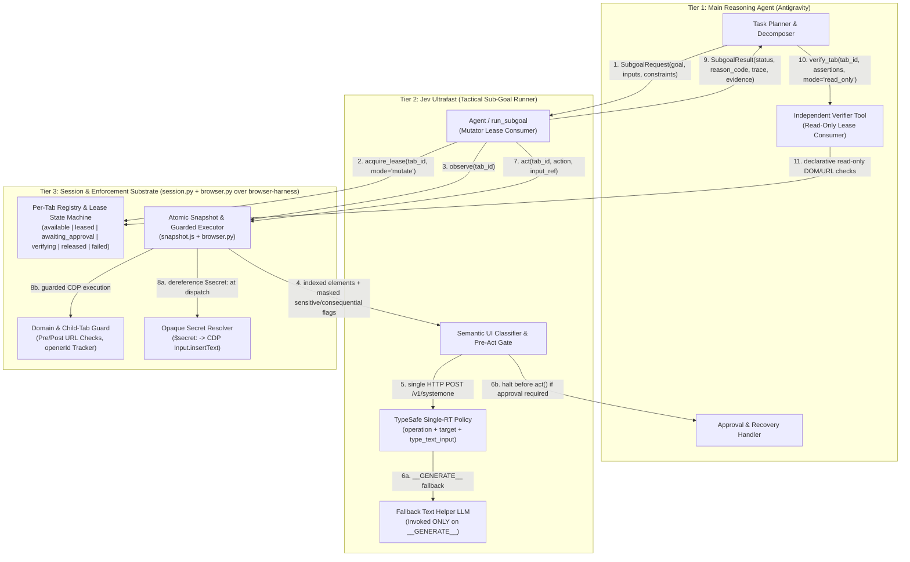
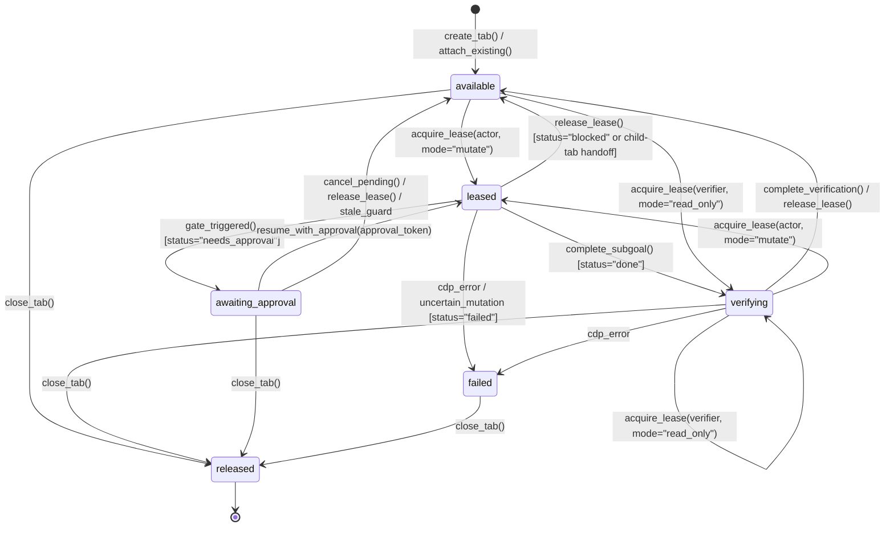

# Jev Ultrafast + Browser Harness as Antigravity's Browser Execution Subsystem

*   **Author:** Antigravity
*   **Status:** Approved
*   **Date:** 2026-10-29

--------------------------------------------------------------------------------

## Overview

This design transforms [`jev-ultrafast`](../../jev_ultrafast/agent.py) (built on `browser-harness`) from a standalone, single-goal demo into the reusable browser execution subsystem for a multi-agent system running inside Antigravity.

The architecture separates web autonomy into three distinct tiers:
1.  **Main Reasoning Agent (Antigravity)**: Owns long-horizon task planning, goal decomposition, cross-tool orchestration, structured input supply (including opaque `$secret:<id>` references), policy configuration, user approval handling, recovery from blocked states, and independent outcome verification.
2.  **Jev Ultrafast (Tactical Sub-Goal Runner)**: Executes bounded navigation and interaction sub-goals (typically 3–15 UI actions, such as finding an account's billing settings or applying search filters) over a leased tab. Each step reads an atomic indexed DOM snapshot and sends a single HTTP request to [TypeSafe](https://docs.typesafe.ai/introduction) (`/v1/systemone`, a constrained-choice inference API that returns calibrated probability distributions across multiple discrete question heads in one round-trip) to select both the operation (`CLICK`, `TYPE_TEXT`, `SELECT`, `SCROLL_UP`, `SCROLL_DOWN`, `WAIT`, `DONE`, `BLOCKED`, `NEEDS_APPROVAL`) and its operation-specific target and input source.
3.  **Browser Session & Enforcement Substrate (`jev_ultrafast/session.py` + `jev_ultrafast/browser.py` over `browser-harness`)**: Uses `browser-harness`'s persistent Chrome DevTools Protocol (CDP) connection to manage a per-tab registry with explicit lifecycle states (`available`, `leased`, `awaiting_approval`, `verifying`, `released`, `failed`), single-mutator lease tokens, child-tab tracking, lowest-layer secret resolution, and deterministic navigation and action gating below the model.

## The Problem

Today, [`jev-ultrafast`](../../jev_ultrafast/agent.py) proves that an indexed DOM action space paired with a single-round-trip TypeSafe policy can drive a browser loop with sub-200ms decision latency. However, five structural limitations prevent it from serving as a dependable browser subsystem inside Antigravity:

1.  **Ephemeral, One-Shot Tab Lifecycle**: [`Browser.__init__`](../../jev_ultrafast/browser.py) and [`Agent.__init__`](../../jev_ultrafast/agent.py) create a new tab on startup, run a single natural-language goal until `DONE` or `BLOCKED`, and unconditionally close the tab on exit. Meanwhile, `browser-harness` (`0.1.13`) tracks singleton daemon state (`self.session`, `self.target_id`, `self.dialog`) and injects a `'🐴 '` marker prefix into `document.title` on load events unless disabled—mutating `document.title` mid-step and causing spurious `StalePage` exceptions in [`snapshot.js`](../../jev_ultrafast/snapshot.js). The main reasoning agent cannot issue sequential sub-goals on the same tab, pause and resume around user approvals, or hand a live tab to an independent verifier without races or state loss.
2.  **Unnecessary Secondary LLM Calls and Secret Exposure Risk on `TYPE_TEXT`**: Whenever Jev selects `TYPE_TEXT`, [`agent.py`](../../jev_ultrafast/agent.py) invokes a secondary text LLM (`field_text`) to infer the string to type from the raw goal and page text. When the upstream reasoning agent already possesses structured inputs, calling a secondary LLM adds 350–600ms of latency and introduces failure modes. Worse, [`snapshot.js`](../../jev_ultrafast/snapshot.js) strips `input[type="password"]` completely (both in its `safe` filter and its `role` mapping), making Jev unable to detect authentication prompts while offering no mechanism to inject credentials without exposing secrets to model contexts or subsequent DOM snapshots.
3.  **Lack of Consequence-Based Safety Boundaries**: Passing constraints like `"do not submit changes"` or `"do not leave this domain"` only in prompt text provides no deterministic guarantee against unintended form submissions, destructive clicks, or cross-domain navigations. At the same time, naive network rules that block all HTTP `POST` requests break modern single-page applications (GraphQL, Next.js Server Actions, Google RPCs) that use `POST` for read-only views.
4.  **Unverified `DONE` Status and Insufficient Diagnostic Evidence**: TypeSafe choosing `DONE` means only that the tactical policy believes the goal is satisfied, not that the outcome actually succeeded. Furthermore, when Jev halts with `BLOCKED`, it returns no structured reason code or constraint telemetry for the main reasoning agent to distinguish between a missing input, a policy gate, a popup tab, or a stalled UI loop.
5.  **Tactical DOM Gaps on Real Web Applications**: [`snapshot.js`](../../jev_ultrafast/snapshot.js) only scrolls the root document at fixed coordinates (`x=550, y=650`), ignores open Shadow DOM roots, omits truncation counts when more than 250 controls exist, and does not track child tabs opened via `target="_blank"` or `window.open()`—causing Jev to triple-click popup links and fail on standard SaaS settings and billing interfaces.

## Goals

*   **Enforce a Three-Tier Responsibility Boundary**: Keep strategic planning, parameter supply, approval escalation, and independent verification in Antigravity; keep fast multi-step tactical UI execution in Jev Ultrafast; and keep tab lifecycle, lease locking, secret dereferencing, and low-level policy enforcement in the session/browser substrate.
*   **Provide Persistent Session and Tab Handles with Explicit Ownership**: Manage tabs through an explicit state machine (`available`, `leased`, `awaiting_approval`, `verifying`, `released`, `failed`) where at most one actor holds mutation authority (`leased`) at a time and independent verifiers receive read-only observation access (`verifying`).
*   **Eliminate Secondary LLM Calls for Known Inputs via Orthogonal `TYPE_TEXT` Heads**: Select both `type_text_target` (the editable element) and `type_text_input` (caller-supplied `input:<key>` vs. `__GENERATE__`) in a single TypeSafe round-trip with $O(N + K)$ choices, invoking the fallback text LLM only when `__GENERATE__` is selected on a non-sensitive field.
*   **Isolate Secrets While Keeping Sensitive Fields Observable**: Expose password and authentication fields in DOM snapshots as masked metadata (`sensitive: true`, `value_required: true`) so Jev can detect credential prompts and return `needs_approval`, while resolving actual values via opaque `$secret:<id>` references strictly inside the lowest execution layer and taint-tracking filled DOM nodes so plaintext secrets never appear in prompts, subsequent snapshots, traces, logs, or screenshots.
*   **Enforce Consequence-Based Safety and Human Approval Gates**: Combine deterministic pre-/post-action domain and navigation boundaries, semantic UI classification of form submissions and consequential controls, pre-execution `needs_approval` pausing (`awaiting_approval`), and human approval tokens without relying on HTTP verbs alone.
*   **Return Structured Execution Telemetry and Read-Only Verification Primitives**: Return a structured `SubgoalResult` (`done | blocked | failed | needs_approval`, `reason_code`, `action_trace`, `constraint_events`, `pending_approval`, `claimed_evidence`, and conditional screenshots) and allow independent verifier tools to inspect live `verifying` tabs declaratively without mutating UI state.
*   **Upgrade Tactical Web Compatibility While Preserving Speed and Backward Compatibility**: Support nested scrollable containers, open Shadow DOM traversal, child-tab (`openerId`) tracking, and framework-compatible input events while keeping the existing `Agent(url, goals)` API and offline test suite working.

## Non-Goals

*   **Using HTTP Methods Alone as the Safety Boundary**: The subsystem will not define read-only mode solely by blocking `POST`/`PUT`/`PATCH`/`DELETE` requests or assuming `GET` requests are side-effect-free.
*   **Cartesian Flattening of `TYPE_TEXT` Choices**: The policy will not flatten `element_index × input_key` into a single combinatorial choice head.
*   **Exposing Plaintext Secrets Above the Execution Substrate**: Plaintext credential values must never appear in planner prompts, TypeSafe payloads, text helper calls, subsequent DOM snapshots, action traces, reviewer logs, or screenshots.
*   **Concurrent Multi-Agent Mutation of the Same Tab**: Two agents or tools may never hold simultaneous mutation authority on the same `tab_id`.
*   **Long-Horizon Planning or Multimodal Fast-Path Loops inside Jev**: Jev Ultrafast will not decompose multi-stage workflows on its own or consume screenshots inside its per-step TypeSafe request loop.
*   **Model-Generated Selectors or Arbitrary Code Execution**: Neither Jev nor verification callers may emit CSS/XPath selectors, screen coordinates, or arbitrary JavaScript strings.
*   **Automatic Retries of Uncertain Browser Mutations**: Any interrupted mutation whose side effect is uncertain transitions the tab to `failed` (`UNCERTAIN_MUTATION_STATE`) for inspection rather than retrying automatically.

## Open Questions

*   *None. All architectural boundaries and interface contracts are resolved in this specification.*

## Critical User Journeys (CUJs)

### CUJ 1: Bounded Read-Only Sub-Goal with Structured Inputs and Independent Verification

*   **Given**: Antigravity holds an authenticated browser session (`session_id="sess_1"`, `tab_id="tab_1"` in state `available`) on an enterprise dashboard and wants to locate the billing settings for account `"Acme Corp"` without submitting changes or leaving the domain.
*   **When**: Antigravity invokes `run_subgoal` with `goal="Find the billing settings for this account"`, `inputs={"account_name": "Acme Corp"}`, `constraints=SubgoalConstraints(allowed_domains=("app.example.com",), mode="read_only")`, and `expected_result={"type": "location_or_blocked"}`.
*   **Then**:
    1.  `Agent` acquires an exclusive mutation lease (`tab_1` transitions `available -> leased`).
    2.  When typing `"Acme Corp"` into the account switcher combobox, TypeSafe selects `operation="TYPE_TEXT"`, `type_text_target="2"`, and `type_text_input="input:account_name"` in one request (`0` calls to the secondary text LLM).
    3.  Jev navigates to `/settings/billing` (including scrolling inside a nested settings container and traversing open Shadow DOM controls), chooses `DONE`, and transitions `tab_1` to `verifying`.
    4.  `run_subgoal` returns `SubgoalResult(status="done", reason_code="GOAL_SATISFIED", final_url="https://app.example.com/settings/billing", ...)`.
    5.  Antigravity invokes `verify_tab` on `tab_1` (acquiring a read-only lease in `verifying` state), which declaratively confirms the URL, heading text, and matched account control values before releasing `tab_1` back to `available`.

### CUJ 2: Consequential Action Interception and `needs_approval` Pause/Resume

*   **Given**: Antigravity issues a sub-goal on `tab_1` where advancing the workflow requires either entering a password into a re-authentication prompt (`sensitive: true`, `value_required: true`) or clicking a consequential button (`"Update Billing Address"` / `"Delete Payment Method"`).
*   **When**: `snapshot.js` exposes the password field with masked metadata (`sensitive: true`, `value_required: true`, `value: ""`) or flags the submit button as consequential, and Jev selects that target (or chooses `NEEDS_APPROVAL`).
*   **Then**:
    1.  The pre-execution gate halts **before** `Browser.act()` dispatches any CDP mouse or key event.
    2.  `tab_1` transitions from `leased` to `awaiting_approval`, storing the paused `page` snapshot, prior step `history`, and a `PendingApproval` record containing a one-time `approval_token`.
    3.  `run_subgoal` returns `SubgoalResult(status="needs_approval", reason_code="CREDENTIAL_ENTRY" | "DESTRUCTIVE_ACTION", pending_approval=PendingApproval(...))`.
    4.  Once the user or policy handler grants approval (supplying `approval_token` and, if applicable, an opaque `inputs={"password": "$secret:corp_pw"}` reference), Antigravity resumes the sub-goal on `tab_1`.
    5.  The harness validates `approval_token`, verifies that `tab_1`'s page state and target node guard still match (`Browser.fresh`), transitions `awaiting_approval -> leased`, dereferences `$secret:corp_pw` strictly inside the low-level input dispatcher (while tainting the target DOM node so subsequent snapshots mask its value as `"[MASKED]"`), and completes execution.

### CUJ 3: Deterministic Boundary Enforcement and Child-Tab Handoff

*   **Given**: Jev is executing a sub-goal on `tab_1` with `allowed_domains=("app.example.com", "billing.example.com")` and clicks a `"Download Invoice / Manage in Portal"` control that either opens a child tab via `target="_blank"` / `window.open()` or attempts to navigate to an unapproved external domain (`external-ads.example.net`).
*   **When**: The action targets a link/form or spawns a child CDP target (`openerId == tab_1`).
*   **Then**:
    1.  If the link `href` or `form.action` points to an unapproved domain (`external-ads.example.net`), the pre-choice/pre-act gate blocks the action before execution and records a `DOMAIN_BOUNDARY_BLOCKED` entry in `constraint_events`.
    2.  If a click spawns a child tab (`tab_2` with `openerId == tab_1`) on an allowed domain (`billing.example.com`), `session.py` registers `tab_2` under `sess_1`, records `forked_tab_ids=["tab_2"]`, releases the mutation lease on `tab_1` (`leased -> available`), acquires the mutation lease on `tab_2` (`available -> leased`), and continues execution on `tab_2` instead of seeing `page_changed=False` and clicking the link three times.
    3.  If a JavaScript redirect or child tab lands on a disallowed domain after a click, `browser.py` immediately halts loading (`Page.stopLoading`) or closes the disallowed child target, records a `DOMAIN_BOUNDARY_BLOCKED` entry in `constraint_events`, and returns `SubgoalResult(status="blocked", reason_code="CONSTRAINT_VIOLATION_BLOCKED")` containing the recorded `constraint_events` and `diagnostic_message`.

## Technical Plan (Architecture)

### 1. Three-Tier Subsystem Architecture & Data Flow

The browser subsystem is structured into three tiers with strict downward control and upward evidence flow:



### 2. Per-Tab Registry, Ownership, and Lifecycle State Machine (`jev_ultrafast/session.py`)

Instead of relying on `browser-harness`'s singleton daemon attributes (`self.session`, `self.target_id`, `self.dialog`) or closing the tab when `Agent` exits, the subsystem manages tabs through an explicit `TabRegistry` scoped by `session_id` and `tab_id`:



#### Lifecycle & Concurrency Invariants
*   **Single-Mutator Authority (`leased`)**: At most one execution actor may hold a `mode="mutate"` lease (`lease_token`) on a `tab_id` at any time. Any concurrent call attempting to mutate (`act`, `navigate`, `reset`) without the active, non-expired `lease_token` is rejected immediately with `LeaseConflictError`. `Browser.act()` validates `assert_active_lease(tab_id, lease_token, mode="mutate")` immediately before dispatching any mutating CDP command.
*   **Paused Approval State (`awaiting_approval`)**: When Jev selects a consequential action or credential field requiring approval (or chooses `NEEDS_APPROVAL`), the tab transitions to `awaiting_approval` *before* `Browser.act()` executes. The tab record persists the paused `page` snapshot (`fingerprint`, `marker`, `page_key`, `guards`, `actions`), prior step `history`, and a `PendingApproval` object containing a one-time `approval_token`:
    *   **Resuming a Concrete Gated Action (`pending_approval.action_id is not None` with a bound or newly supplied input)**: Validating `approval_token` checks `Browser.fresh(paused_page, action)`. If the page changed while awaiting human approval, the tab transitions to `available` and returns `status="blocked", reason_code="STALE_PAGE_EXHAUSTED"`. If fresh, it transitions `awaiting_approval -> leased`, executes that approved action once, and continues the sub-goal loop with the preserved `history`.
    *   **Resuming a Model-Escalated `NEEDS_APPROVAL` or Late-Bound Credential (`pending_approval.action_id is None` or credential key supplied on resume)**: Validating `approval_token` checks `Browser.fresh(paused_page)`, transitions `awaiting_approval -> leased`, marks the approved consequence category as permitted for the current `page_fingerprint`, and runs `choose()` with the caller's updated `inputs` so TypeSafe binds `type_text_input="input:<key>"`.
*   **Read-Only Verification State (`verifying`)**: When a sub-goal terminates with `status="done"`, the tab transitions `leased -> verifying`. Independent verifiers attach with `acquire_lease(verifier, mode="read_only")` (`verifying -> verifying` or `available -> verifying`). In `verifying` state, all mutating operations are blocked; only declarative read-only observation, full-text/control inspection, URL inspection, and screenshot capture are permitted.
*   **Uncertain Mutation Quarantine (`failed`)**: If a DOM/CDP error interrupts an action *after* input dispatch begins (such as a native `<select>` interruption or a post-click/post-insertText transport failure), the tab transitions to `failed` with `reason_code="UNCERTAIN_MUTATION_STATE"` rather than raising `StalePage` or retrying automatically.
*   **Title-Marker Isolation & Child-Tab Tracking**:
    *   Before calling `ensure_daemon()`, `jev_ultrafast` sets `os.environ.setdefault("BH_TAB_MARKER", "0")` so `browser-harness` does not inject `'🐴 '` into tab titles, and [`snapshot.js`](../../jev_ultrafast/snapshot.js) strips any leading `'🐴 '` prefix when reading `document.title` so title markers never trigger spurious `StalePage` errors.
    *   After each executed action, `session.py` polls CDP targets (`Target.getTargets`) where `openerId == tab_id`. Newly opened child tabs on allowed domains are registered under `session_id` and recorded in `forked_tab_ids`. Under `follow_new_tabs="auto"`, the parent tab's mutation lease is released (`leased -> available`), the child tab transitions `available -> leased`, the parent step records `page_changed=True`, and execution continues on the child tab (which becomes `SubgoalResult.tab_id`).

### 3. Orthogonal `TYPE_TEXT` Heads & Opaque `$secret:<id>` Resolution (`jev_ultrafast/model.py` & `jev_ultrafast/browser.py`)

#### Orthogonal Speculative Heads in One TypeSafe Request
To avoid flattening $N$ editable elements by $K$ caller-supplied inputs into an $O(N \times K)$ Cartesian choice head, [`choose()`](../../jev_ultrafast/model.py) adds a second speculative head (`type_text_input`) alongside `type_text_target` whenever `TYPE_TEXT` candidates exist and `inputs` are provided:

```text
                       one TypeSafe /v1/systemone request
                      ┌──────────────────────────────────────────┐
page + inputs ──────→ │ operation        (CLICK, TYPE_TEXT, ...) │
                      │ click_target     (1 .. M_click)          │
                      │ type_text_target (1 .. N_fill)           │
                      │ type_text_input  (input:<k> | __GENERATE__) │
                      │ select_target    (if <select> present)   │
                      └────────────────────┬─────────────────────┘
                                           │
               if operation == TYPE_TEXT:  ├─→ target = type_text_target
                                           └─→ source = type_text_input
                                                  ├── "input:<k>" ──→ deterministic lookup (0 LLM calls)
                                                  └── "__GENERATE__" → field_text() helper LLM
```

*   **`type_text_target` Criteria**: Maps each editable element index (`"1"`, `"2"`, ...) to its observed role, label, masked current value, and `sensitive` / `value_required` flags.
*   **`type_text_input` Criteria**:
    *   For each key `k, v` in caller-supplied `inputs`: `"input:" + k` with metadata `{"key": k, "kind": "secret_ref" if is_secret_ref(v) else "literal", "preview": "[SECRET]" if is_secret_ref(v) else truncate(v, 80)}`.
    *   `"__GENERATE__"`: `"Compose or transform a field value using the text helper because no supplied input key directly matches this field."`
*   **Execution Path**:
    *   If `operation != "TYPE_TEXT"`, both `type_text_target` and `type_text_input` are ignored.
    *   If `operation == "TYPE_TEXT"` and `type_text_input` selects `"input:<k>"`, Jev binds the input reference directly with **zero secondary LLM calls**.
    *   If `operation == "TYPE_TEXT"` and `type_text_input == "__GENERATE__"` (or `inputs` is empty):
        *   If the target element has `sensitive: true`, Jev never invokes `field_text()` (which would guess or hallucinate a credential); it halts with `status="needs_approval", reason_code="CREDENTIAL_ENTRY"` (or `status="blocked", reason_code="MISSING_INPUT_VALUE"` if credential approval was already granted without supplying a matching input).
        *   Otherwise, Jev invokes [`field_text()`](../../jev_ultrafast/model.py) using the existing `pending_text` stale-retry cache.

#### Masked Sensitive Fields, Node Taint Tracking & Lowest-Layer `$secret:<id>` Resolution
*   **Observable Masked Metadata**:
    *   [`snapshot.js`](../../jev_ultrafast/snapshot.js) includes password and authentication inputs (`type="password"`, or `autocomplete` matching `current-password`, `new-password`, `one-time-code`, or `cc-*`, or any DOM node previously tainted in `window.__jevFast.secretNodes`) as editable `textbox` controls with `sensitive: true`, `value_required: !e.value`, and masked value `e.value ? "[MASKED]" : ""` across `actions`, `pageKey()`, and `guard()`.
*   **Per-Node Freshness Guard & Lowest-Layer Dereferencing**:
    *   `Browser.fresh(page, action)` enforces per-node semantic and context guard verification (`page["guards"]`) for `fill` actions in addition to `click` and `select` actions.
    *   Callers pass secrets as opaque string tokens matching `"$secret:<id>"` (e.g., `inputs={"password": "$secret:corp_portal_pw"}`).
    *   Inside `Browser.act()`, immediately before dispatching `Input.insertText`, if the value matches `"$secret:<id>"`, the executor resolves the plaintext via a server-side `SecretResolver` callback, marks the target DOM node in `window.__jevFast.secretNodes` (so all subsequent `observe()` and `verify_tab()` reads permanently mask that node's value as `"[MASKED]"` even if its input type is `text`), dispatches `Input.insertText`, and clears the local variable.
    *   `history["text"]` and `recent_actions` record only `"[SECRET]"` (never the plaintext secret and never the internal secret ID), while `action_trace` records `input_source="input:<key>"`. Whenever a filled sensitive or secret-tainted control is visible in the viewport, screenshot capture is suppressed (`screenshot_b64 = None`).

### 4. Consequence-Based Policy & Safety Engine (`jev_ultrafast/policy.py`)

Because HTTP methods (`POST` vs. `GET`) do not reliably distinguish read-only actions from consequential mutations on modern web applications, policy enforcement combines four coordinated layers inside `jev_ultrafast`:

| Layer | Enforcement Point | Mechanism | Behavior on Violation / Trigger |
| :--- | :--- | :--- | :--- |
| **1. Domain & Navigation Boundary** | `snapshot.js`, `policy.py`, `browser.py`, `session.py` | Validates resolved `<a href>`, `<form action>`, and `<button formaction>` URLs against `allowed_domains` / `denied_domains` before choice and before execution, and verifies the post-action page URL and child targets (`openerId == tab_id`). | Excludes disallowed cross-domain links pre-choice; if a JS redirect or popup crosses a domain boundary post-click, calls `Page.stopLoading` / closes the disallowed child tab, records `DOMAIN_BOUNDARY_BLOCKED` in `constraint_events`, and halts with `status="blocked", reason_code="CONSTRAINT_VIOLATION_BLOCKED"`. |
| **2. Semantic UI Action Classification** | `snapshot.js` & `policy.py` | Tags controls with canonical consequence categories: `credentials` (`sensitive: true` or `$secret:<id>` input), `destructive` (delete, remove, revoke, cancel subscription, close account), `payment` (pay, purchase, checkout, upgrade, billing confirm), `send` (send, post, publish, invite), `submit_in_read_only` (`form_submit: true` when `mode="read_only"`, excluding search inputs/forms), and `external_navigation`. | Attaches `consequence_categories` to each candidate action for pre-choice and pre-act evaluation. |
| **3. Pre-Choice Filtering & `NEEDS_APPROVAL` Head** | `model.py` | Adds `NEEDS_APPROVAL` to `operations` when approval gates are active so TypeSafe can explicitly report when the only path forward requires a gated action or missing credential. | Model selects `NEEDS_APPROVAL` (or selects the gated target, caught deterministically at Layer 4). |
| **4. Pre-Execution `needs_approval` Gate** | `agent.py` (before `browser.act()`) | Inspects the selected `(operation, target, input_source)` against `constraints.require_approval_for` and `constraints.mode`. | Halts **before** `browser.act()`, transitions the tab to `awaiting_approval`, stores `PendingApproval` with a one-time `approval_token`, and returns `status="needs_approval"`. |

### 5. Tactical DOM Compatibility Upgrades (`snapshot.js` & `browser.py`)

1.  **Nested Scroll Container Detection**:
    *   In addition to the root document scroller, [`snapshot.js`](../../jev_ultrafast/snapshot.js) detects the active scrollable container (open modal dialogs, listboxes, or the largest visible scrollable container whose scroll height exceeds its client height).
    *   `scroll_down` and `scroll_up` actions carry the target coordinates `(x, y)` of that container's visible center, and the container's scroll offset is included in `state["scroll"]`, `pageKey()`, and `marker` so scrolling inside a modal updates `fingerprint(state)` (`page_changed=True`).
2.  **Open Shadow DOM Traversal & Composed Hit-Testing**:
    *   [`snapshot.js`](../../jev_ultrafast/snapshot.js) traverses open `shadowRoot` trees when collecting interactive controls, visible text, `pageKey()` form states, accessible names (`aria-labelledby` within the shadow root), and scoped context guards.
    *   [`browser.py`](../../jev_ultrafast/browser.py) drills into nested open `shadowRoot.elementFromPoint(x, y)` targets and walks up the composed ancestor chain (`parentElement` or `getRootNode().host`) to verify click target visibility without false rejections at shadow boundaries.
3.  **Framework-Compatible Input Replacement Without Post-Mutation Retries**:
    *   [`browser.py`](../../jev_ultrafast/browser.py) selects the platform Select-All modifier from the browser's `navigator.platform` rather than the Python host OS, and dispatches a post-`Input.insertText` bubbling `change` event inside a guarded post-mutation block that never raises `StalePage` if an event handler navigates the page.
4.  **Explicit Truncation Telemetry**:
    *   [`model.py`](../../jev_ultrafast/model.py) forwards `omitted_actions` (`state.get("omitted_actions", 0)`) in `body["state"]["page"]` and `SubgoalResult.omitted_actions_count` exposes the count to callers.

### 6. Subsystem API & Data Schemas (`jev_ultrafast/contracts.py`)

#### Input Schemas: `SubgoalConstraints` & `SubgoalRequest`

```python
ConsequenceCategory = Literal[
    "credentials",
    "payment",
    "destructive",
    "submit_in_read_only",
    "external_navigation",
    "send",
]

@dataclass(frozen=True)
class SubgoalConstraints:
    allowed_domains: tuple[str, ...] = ()
    denied_domains: tuple[str, ...] = ()
    mode: Literal["read_only", "interactive", "transactional"] = "interactive"
    require_approval_for: frozenset[ConsequenceCategory] = frozenset(
        {"credentials", "payment", "destructive", "submit_in_read_only", "external_navigation", "send"}
    )
    follow_new_tabs: Literal["auto", "record_only", "block"] = "auto"
    max_steps: int = 25
    max_duration_ms: int = 30_000


@dataclass(frozen=True)
class SubgoalRequest:
    goal: str
    session_id: str | None = None
    tab_id: str | None = None
    lease_token: str | None = None
    start_url: str | None = None
    inputs: dict[str, str] = field(default_factory=dict)  # Values may be literals or "$secret:<id>"
    constraints: SubgoalConstraints = field(default_factory=SubgoalConstraints)
    expected_result: dict[str, Any] = field(default_factory=lambda: {"type": "location_or_blocked"})
    approval_token: str | None = None                     # Resumes a tab in `awaiting_approval`
    capture_screenshot: Literal["on_risk_or_done", "always", "never"] = "on_risk_or_done"
```

#### Output Schemas: `PendingApproval`, `ConstraintEvent`, `SubgoalResult`, and `VerificationReport`

```python
TabState = Literal["available", "leased", "awaiting_approval", "verifying", "released", "failed"]
SubgoalStatus = Literal["done", "blocked", "failed", "needs_approval"]
ReasonCode = Literal[
    "GOAL_SATISFIED",
    "CREDENTIAL_ENTRY",
    "FORM_SUBMIT_GATED",
    "DESTRUCTIVE_ACTION",
    "PAYMENT_ACTION",
    "SEND_ACTION",
    "EXTERNAL_DOMAIN_GATED",
    "MODEL_ESCALATED_APPROVAL",
    "CONSTRAINT_VIOLATION_BLOCKED",
    "MISSING_INPUT_VALUE",
    "NO_PROGRESS_3X",
    "STEP_BUDGET_EXCEEDED",
    "TIME_BUDGET_EXCEEDED",
    "MODEL_BLOCKED",
    "UNCERTAIN_MUTATION_STATE",
    "CDP_PROTOCOL_ERROR",
    "STALE_PAGE_EXHAUSTED",
]


@dataclass(frozen=True)
class PendingApproval:
    approval_token: str
    reason_code: ReasonCode
    consequence_categories: tuple[ConsequenceCategory, ...]
    operation: str
    action_id: str | None
    target_node: int | None
    target_label: str | None
    input_source: str | None
    page_fingerprint: str


@dataclass(frozen=True)
class ConstraintEvent:
    event_type: Literal["DOMAIN_BOUNDARY_BLOCKED", "ACTION_FILTERED", "APPROVAL_GATE_PAUSED"]
    message: str
    url: str | None = None
    action_label: str | None = None
    consequence_categories: tuple[ConsequenceCategory, ...] = ()


@dataclass
class SubgoalResult:
    status: SubgoalStatus
    reason_code: ReasonCode
    diagnostic_message: str
    session_id: str
    tab_id: str
    tab_state: TabState
    forked_tab_ids: list[str]
    final_url: str
    page_title: str
    page_fingerprint: str
    distilled_elements: list[dict[str, Any]]
    visible_text_excerpt: str
    omitted_actions_count: int
    action_trace: list[dict[str, Any]]
    constraint_events: list[ConstraintEvent]
    pending_approval: PendingApproval | None
    claimed_evidence: dict[str, Any]
    screenshot_b64: str | None
    metrics: dict[str, int]


@dataclass(frozen=True)
class VerificationReport:
    passed: bool
    session_id: str
    tab_id: str
    tab_state: TabState
    url: str
    title: str
    checks: dict[str, bool]
    details: dict[str, Any]
```

#### Read-Only Independent Verification API (`verify_tab`)

```python
def verify_tab(
    session_id: str,
    tab_id: str,
    *,
    registry: TabRegistry | None = None,
    url_matches: str | None = None,
    title_matches: str | None = None,
    required_text: list[str] | None = None,
    forbidden_text: list[str] | None = None,
    control_values: dict[str, str] | None = None,
    release_on_pass: bool = True,
) -> VerificationReport:
    """Evaluates declarative, read-only checks against a tab in `verifying` or `available` state."""
```

## Alternatives Considered

### Alternative 1: Use HTTP Method Blocking (`POST`/`PUT`/`PATCH`/`DELETE`) Alone as the Read-Only Safety Boundary

*   **Pros**: Simple to specify as a static network filter rule; requires no semantic inspection of DOM elements or form structures.
*   **Cons**:
    *   Modern single-page applications routinely use `POST` requests for read-only operations, including GraphQL queries (`POST /graphql`), Next.js Server Actions, Google's internal `batchexecute` RPCs (used by Google Flights and Google Workspace), and autocomplete/search endpoints. Blocking all `POST` requests breaks normal page rendering and causes Jev to loop in `WAIT` or fail with false `blocked` states.
    *   Conversely, web applications can trigger consequential state mutations via `GET` links or client-side event handlers.
    *   Furthermore, intercepting `Fetch.requestPaused` events from the Python client over `browser-harness`'s synchronous IPC socket and 500-event ring buffer risks deadlocks and dropped requests when the event buffer overflows.
*   **Reason for Rejection**: HTTP verbs are unreliable proxies for real-world consequence. Safety requires combining deterministic domain/navigation boundaries, semantic UI classification of form submissions and consequential controls, pre-execution `needs_approval` gates, and human approval escalation.

### Alternative 2: Encode `TYPE_TEXT` as a Flattened Cartesian Product (`element_index:input_key`) in `type_text_target`

*   **Pros**: Reuses the exact `index:sub_index` string convention already used by `SELECT` (`1:1`, `1:2` in [`jev_ultrafast/model.py`](../../jev_ultrafast/model.py)) without adding a new question key to the TypeSafe request.
*   **Cons**:
    *   While native `<select>` options belong only to a single `<select>` element, any caller-supplied input key can potentially map to any editable textbox on the page. With $N$ editable fields and $K$ input keys, flattening produces $N \times K$ candidate choices (plus $N$ generative fallback choices).
    *   Inflates the TypeSafe request payload on every step—even when the chosen operation is `CLICK`—and dilutes probability mass across dozens of combinations, increasing the risk of failing [`validate_choice`](../../jev_ultrafast/model.py) (`abs(sum(probabilities.values()) - 1) < 0.02`).
*   **Reason for Rejection**: Using two orthogonal speculative heads (`type_text_target` over $N$ elements and `type_text_input` over $K + 1$ input sources) inside the same TypeSafe request preserves single-round-trip latency with $O(N + K)$ choices instead of $O(N \times K)$.

### Alternative 3: Keep `browser-harness` Singleton Session Globals or Allow Uncoordinated Multi-Agent Tab Access

*   **Pros**: Requires zero session-management additions around [`jev_ultrafast/browser.py`](../../jev_ultrafast/browser.py).
*   **Cons**:
    *   `browser_harness/daemon.py` tracks only a single `self.session`, `self.target_id`, and `self.dialog`, and injects a `'🐴 '` prefix into `document.title` on load events—which mutates `document.title` mid-step and triggers spurious `StalePage` errors in [`snapshot.js`](../../jev_ultrafast/snapshot.js).
    *   Without explicit tab lifecycle states and single-mutator lease tokens, concurrent agents or verification tools can interleave clicks, corrupt form state, or close tabs underneath an active runner.
*   **Reason for Rejection**: Multi-agent orchestration requires a per-tab registry with explicit lifecycle states (`available`, `leased`, `awaiting_approval`, `verifying`, `released`, `failed`), single-mutator lease authority, and read-only observation access for independent verifiers.

### Alternative 4: Either Hide Password Fields Completely (`safe()` Filter) or Pass Plaintext Secrets in `inputs`

*   **Pros**: Hiding password fields (`!['password','file','hidden'].includes(e.type)`) avoids any risk of interacting with login forms; passing plaintext secrets in `inputs` requires no secret-store indirection.
*   **Cons**:
    *   Completely hiding `input[type="password"]` prevents Jev from detecting login and re-authentication walls, causing it to spin or return an uninformative `blocked` status instead of escalating with `status: "needs_approval"` (`CREDENTIAL_ENTRY`).
    *   Passing plaintext secrets through planner prompts, TypeSafe requests, text helper calls, action traces, or screenshots leaks sensitive credentials into model contexts and persistent logs.
*   **Reason for Rejection**: Exposing password/authentication fields as masked metadata (`sensitive: true`, `value_required: true`, `value: ""` or `"[MASKED]"`) while resolving opaque `$secret:<id>` tokens strictly at the lowest execution layer (and taint-tracking the target DOM node) satisfies both authentication awareness and strict credential isolation.

### Alternative 5: Keep `Agent` as a Stateless One-Shot Runner and Return Full Snapshots/Screenshots on Every Step

*   **Pros**: Matches the current [`Agent(url, goals)`](../../jev_ultrafast/agent.py) demo loop where every run starts from a fresh URL and terminates by closing its tab.
*   **Cons**:
    *   Destroying the tab at the end of a sub-goal prevents the main reasoning agent from issuing follow-up sub-goals on the reached page, pausing and resuming around `needs_approval`, or running independent verification checks against the live tab.
    *   Dumping full 250-element tables and base64 screenshots into the main reasoning agent's context window after every granular step bloats planner token usage and latency.
*   **Reason for Rejection**: Persistent session/tab handles paired with compact `SubgoalResult` summaries and live read-only verifier primitives (`verify_tab`) preserve Jev's speed advantage while enabling multi-turn agent workflows.

## Non-Functional Requirements

*   **Security & Secret Isolation**:
    *   Plaintext values referenced by `$secret:<id>` must never be serialized into `SubgoalRequest` logs, TypeSafe `/v1/systemone` payloads, `field_text` LLM prompts, subsequent `observe()` or `verify_tab()` reads, `action_trace` entries, `SubgoalResult` payloads, or error messages.
    *   `history["text"]` and `recent_actions` record `"[SECRET]"` whenever a `$secret:<id>` reference is typed, and screenshot capture is suppressed (`screenshot_b64 = None`) whenever a filled sensitive or secret-tainted control is visible in the viewport.
    *   Page text and element labels remain untrusted data; models and verifiers may only use code-owned element indices, structured input keys, and declarative verification checks, never emitting selectors or executable JavaScript.
*   **Performance & Latency**:
    *   The fast-path decision cycle (`observe -> choose -> act`) must remain a **single TypeSafe network round-trip** per step (`0` secondary LLM calls whenever `type_text_input` selects a caller-supplied `input:<key>`).
    *   DOM snapshot collection (`snapshot.js`), including nested scroll container detection, open Shadow DOM traversal, and semantic action classification, must execute atomically in a single `Runtime.evaluate` call with `< 15 ms` median overhead on pages with up to 1,000 DOM nodes.
*   **Rollout & Backward Compatibility**:
    *   The existing `Agent(url, goals, *, record_dir=None, screenshots=False)` constructor and `.run()` / `.command()` methods in [`jev_ultrafast/agent.py`](../../jev_ultrafast/agent.py) must remain backward-compatible by automatically creating an ephemeral leased tab (`close_on_exit=True`) when `session_id` / `tab_id` are not supplied.
    *   All offline unit tests (`uv run pytest`), guard checks (`scripts/check_guards.py`), and linting/build checks (`uv run ruff check .`, `node --check`, `uv build`) must pass without network access or paid API calls.

--------------------------------------------------------------------------------

## Detailed Implementation Plan

### Target Files to Create/Modify

#### 1. [`./jev_ultrafast/contracts.py`](../../jev_ultrafast/contracts.py) (Create)

*   **Type / Scope**: Python Module (Subsystem Data Contracts, Enums, and Secret Reference Helpers)
*   **Rationale**: Centralizes the formal boundary schemas (`SubgoalConstraints`, `SubgoalRequest`, `PendingApproval`, `ConstraintEvent`, `SubgoalResult`, `VerificationReport`), custom exceptions (`LeaseConflictError`, `UncertainMutationError`), and secret masking helpers so `agent.py`, `session.py`, `policy.py`, `verifier.py`, and external Antigravity callers share one strict, typed contract.
*   **Proposed Changes**:
    *   Define `TabState`, `SubgoalStatus`, `ConsequenceCategory`, and `ReasonCode` literal types matching Section 6.
    *   Define `LeaseConflictError(RuntimeError)` and `UncertainMutationError(RuntimeError)`.
    *   Define frozen dataclasses `SubgoalConstraints`, `SubgoalRequest`, `PendingApproval`, `ConstraintEvent`, and `VerificationReport`, plus `SubgoalResult` matching Section 6.
    *   Define `is_secret_ref(value: str) -> bool` (returns `True` when `isinstance(value, str) and value.startswith("$secret:") and len(value) > 8`), `extract_secret_id(value: str) -> str`, `mask_inputs_for_model(inputs: dict[str, str]) -> dict[str, dict[str, str]]` (which maps each key `k, v` to `{"key": k, "kind": "secret_ref", "preview": "[SECRET]"}` when `is_secret_ref(v)` else `{"key": k, "kind": "literal", "preview": v[:80]}`), and `SecretResolver = Callable[[str], str]`.

#### 2. [`./jev_ultrafast/session.py`](../../jev_ultrafast/session.py) (Create)

*   **Type / Scope**: Python Module (Per-Tab Registry, Lease State Machine, and Child-Tab Tracking)
*   **Rationale**: Replaces the single-use tab creation/destruction lifecycle in `browser.py` and isolates Jev from `browser-harness`'s singleton daemon state (`self.session`, `self.target_id`, `self.dialog`), preventing concurrent multi-agent tab corruption and tracking popup/new-tab workflows (`openerId`).
*   **Proposed Changes**:
    *   Set `os.environ.setdefault("BH_TAB_MARKER", "0")` before calling `ensure_daemon()` so `browser-harness` does not inject `'🐴 '` into tab titles on load events.
    *   Implement `TabRecord` storing `session_id: str`, `tab_id: str` (`targetId`), `cdp_session_id: str`, `state: TabState`, `lease_token: str | None`, `lease_owner: str | None`, `lease_mode: Literal["mutate", "read_only"] | None`, `lease_expires_at: float | None`, `close_on_release: bool`, `pending_approval: PendingApproval | None`, `paused_page: dict[str, Any] | None`, `paused_action: dict[str, Any] | None`, `paused_history: list[dict[str, Any]]`, `approved_categories_for_fingerprint: tuple[str, set[str]] | None`, `parent_tab_id: str | None`, `forked_tab_ids: list[str]`, and `constraint_events: list[ConstraintEvent]`.
    *   Implement `TabRegistry` (with a module-level `DEFAULT_REGISTRY = TabRegistry()` singleton and thread lock):
        *   `create_tab(session_id: str | None = None, start_url: str | None = None, close_on_release: bool = False) -> TabRecord`: creates a background CDP target via `Target.createTarget` and attaches via `Target.attachToTarget(flatten=True)`, configures viewport/focus emulation, and initializes `state="available"`.
        *   `acquire_lease(session_id: str, tab_id: str, owner: str = "agent", mode: Literal["mutate", "read_only"] = "mutate", ttl_ms: int = 30_000) -> str`:
            *   Reclaims expired leases if `lease_expires_at` has passed.
            *   For `mode="mutate"`: allowed when `state in {"available", "verifying"}` and no active mutator lease is held; transitions `state -> "leased"` and returns a new `lease_token`. Raises `LeaseConflictError` if `state in {"leased", "awaiting_approval"}` with a different active token or if `state in {"failed", "released"}`.
            *   For `mode="read_only"`: allowed when `state in {"available", "verifying"}`; transitions `state -> "verifying"` and returns a read-only `lease_token`.
        *   `assert_active_lease(tab_id: str, lease_token: str | None, mode: Literal["mutate", "read_only"] = "mutate") -> TabRecord`: verifies `lease_token` matches, has not expired (`time.monotonic() <= lease_expires_at`), and matches `mode` (`state == "leased"` for `"mutate"`). Raises `LeaseConflictError` on mismatch or expiration.
        *   `pause_for_approval(tab_id: str, lease_token: str, pending_approval: PendingApproval, paused_page: dict[str, Any], paused_action: dict[str, Any] | None, paused_history: list[dict[str, Any]]) -> None`: validates the active mutator lease, stores `(pending_approval, paused_page, paused_action, paused_history)`, and transitions `leased -> awaiting_approval`.
        *   `resume_with_approval(tab_id: str, approval_token: str, owner: str = "agent", ttl_ms: int = 30_000) -> tuple[TabRecord, str]`: validates that `state == "awaiting_approval"` and `pending_approval.approval_token == approval_token`, records `approved_categories_for_fingerprint = (pending_approval.page_fingerprint, set(pending_approval.consequence_categories))`, mints a new mutator `lease_token`, transitions `awaiting_approval -> leased`, and returns `(record, lease_token)`.
        *   `transition_to_verifying(tab_id: str, lease_token: str) -> None` (`leased -> verifying`), `release_lease(tab_id: str, lease_token: str | None = None) -> None` (`leased/verifying/awaiting_approval -> available`, or closes target if `close_on_release=True`), `mark_failed(tab_id: str, reason_code: ReasonCode, detail: str) -> None` (`* -> failed`), and `close_tab(tab_id: str) -> None` (`available/verifying/awaiting_approval/failed -> released` and calls `Target.closeTarget`).
        *   `poll_child_tabs(tab_id: str) -> list[TabRecord]`: queries `cdp("Target.getTargets")`, finds any target with `openerId == tab_id` not yet registered, attaches to it, registers it under the parent's `session_id`, and appends its `tab_id` to the parent record's `forked_tab_ids`.

#### 3. [`./jev_ultrafast/policy.py`](../../jev_ultrafast/policy.py) (Create)

*   **Type / Scope**: Python Module (Domain Boundary Checks, Semantic Action Classification, and Pre-Execution Gating)
*   **Rationale**: Enforces domain boundaries, semantic action classification, and pre-execution approval gates without relying on HTTP methods (`POST`/`GET`) alone as a proxy for consequence.
*   **Proposed Changes**:
    *   Implement `check_domain_allowed(url: str, constraints: SubgoalConstraints) -> tuple[bool, str | None]`:
        *   Permits empty URLs, `about:blank`, `data:`, and `javascript:` pseudo-URLs (which do not leave the current origin).
        *   Parses the hostname via `urllib.parse.urlparse(url)`. Rejects if the hostname matches any pattern in `constraints.denied_domains` or if `constraints.allowed_domains` is non-empty and the hostname does not match any allowed domain (supporting exact match and `*.example.com` subdomain suffix match).
    *   Implement `classify_action_consequence(action: dict[str, Any], input_source: str | None, inputs: dict[str, str], constraints: SubgoalConstraints, current_url: str = "") -> tuple[ConsequenceCategory, ...]`:
        *   `credentials`: added if `action.get("sensitive") is True` or (`input_source` starts with `"input:"` and `is_secret_ref(inputs.get(input_source.removeprefix("input:"), ""))`).
        *   `destructive`: added if `action["kind"] in {"click", "select"}` and word-boundary regex on `action["label"]` or `action.get("consequence_hint", "")` matches `\b(delete|remove|destroy|revoke|cancel\s+subscription|close\s+account|erase|purge)\b` (case-insensitive).
        *   `payment`: added if `action["kind"] in {"click", "select"}` and word-boundary regex matches `\b(pay|purchase|buy\s+now|checkout|place\s+order|upgrade\s+plan|confirm\s+payment|subscribe)\b`.
        *   `send`: added if `action["kind"] == "click"` and word-boundary regex matches `\b(send|post\s+comment|publish|broadcast|invite\s+member)\b`.
        *   `submit_in_read_only`: added when `constraints.mode == "read_only"` and `action["kind"] == "click"` and (`action.get("form_submit") is True` or word-boundary regex on `action["label"]` matches `\b(save|update|submit|apply\s+changes|confirm|create)\b`), excluding search actions (`\b(search|find|filter|sort)\b` or `role == "searchbox"`).
        *   `external_navigation`: added if `action.get("href")` is a valid HTTP(S) URL whose hostname differs from `urlparse(current_url).hostname` (or violates `check_domain_allowed`).
    *   Implement `map_categories_to_reason_code(categories: Iterable[ConsequenceCategory]) -> ReasonCode` using deterministic priority order:
        1. `"credentials"` -> `"CREDENTIAL_ENTRY"`
        2. `"destructive"` -> `"DESTRUCTIVE_ACTION"`
        3. `"payment"` -> `"PAYMENT_ACTION"`
        4. `"send"` -> `"SEND_ACTION"`
        5. `"submit_in_read_only"` -> `"FORM_SUBMIT_GATED"`
        6. `"external_navigation"` -> `"EXTERNAL_DOMAIN_GATED"`
    *   Implement `evaluate_pre_choice_actions(actions: list[dict[str, Any]], constraints: SubgoalConstraints, current_url: str = "") -> tuple[list[dict[str, Any]], list[ConstraintEvent]]`:
        *   For each action, checks `action.get("href")` against `check_domain_allowed`. If disallowed, excludes the action from the candidate list and records `ConstraintEvent(event_type="DOMAIN_BOUNDARY_BLOCKED", ...)`.
        *   Annotates remaining actions with `consequence_categories`.
    *   Implement `evaluate_pre_act_gate(action: dict[str, Any], operation: str, input_source: str | None, inputs: dict[str, str], constraints: SubgoalConstraints, page_fingerprint: str, current_url: str = "", approved_categories: set[str] | None = None) -> PendingApproval | None`:
        *   Computes `categories = set(classify_action_consequence(action, input_source, inputs, constraints, current_url))`.
        *   Subtracts any `approved_categories` already approved for `page_fingerprint`.
        *   Intersects remaining categories with `constraints.require_approval_for` (and always gates `"credentials"` when `action.get("sensitive")` has no bound `input:<key>` in `inputs`).
        *   If gated categories remain, mints a `secrets.token_urlsafe(24)` `approval_token` and returns `PendingApproval(...)`.

#### 4. [`./jev_ultrafast/snapshot.js`](../../jev_ultrafast/snapshot.js) (Modify)

*   **Type / Scope**: Browser-Side JavaScript Snapshot Script
*   **Rationale**: Closes five DOM observation gaps in `snapshot.js`: omitted password fields, unindexed nested scroll containers, unindexed open Shadow DOM trees, title-marker `StalePage` collisions, and missing structural consequence metadata.
*   **Proposed Changes**:
    *   **Cache Initialization & Secret Node Taint Set**: Initialize `const cache = window.__jevFast ||= {ids:new WeakMap(), nodes:new Map(), secretNodes:new WeakSet(), next:1}; cache.secretNodes ||= new WeakSet();`.
    *   **Title Normalization**: Define `const cleanTitle = document.title.replace(/^\u{1F434}\s*/u, '');` and use `cleanTitle` in both `marker` and the returned `title` field.
    *   **Observable Masked Sensitive Fields & `role(e)` Fix**:
        *   Change `safe` at line 9 from `!['password','file','hidden'].includes(e.type)` to `!['file','hidden'].includes(e.type)`.
        *   In `role(e)` at line 40, change `['text','email','url','tel'].includes(e.type)` to `['text','email','url','tel','password'].includes(e.type)` so `<input type="password">` receives role `'textbox'` instead of `null`.
        *   Define `const sensitive = e => Boolean(cache.secretNodes.has(e) || e.type==='password' || /^(current-password|new-password|one-time-code|cc-)/.test(e.getAttribute('autocomplete')||''));`.
        *   In `cache.pageKey()`, `cache.guard(e)`, and `actions` construction: when `sensitive(e)` is true, mask the value as `e.value ? '[MASKED]' : ''` (never exposing raw value or character count) and set `sensitive: true` and `value_required: !e.value` on both the `'fill'` and `'click'` (`Open ...`) action entries.
    *   **Consequence & Origin Metadata**:
        *   For links (`a[href]`) and buttons/inputs associated with a form (`e.form`), attach `href: e.href || e.formAction || e.form?.action || ''` and `form_submit: Boolean(e.type==='submit' || (e.tagName==='BUTTON' && e.form && e.type!=='button'))` on `base`.
    *   **Open Shadow DOM Traversal**:
        *   Define a recursive helper `const queryAll = (root, sel, out=[]) => { for (const e of root.querySelectorAll(sel)) { out.push(e); if (e.shadowRoot) queryAll(e.shadowRoot, sel, out); } for (const e of root.querySelectorAll('*')) if (e.shadowRoot && !e.matches(sel)) queryAll(e.shadowRoot, sel, out); return out; };` (deduplicating visited shadow roots).
        *   Use `queryAll(document, 'input,textarea,select')` in `cache.pageKey()` and `queryAll(document, selector)` in the `actions` loop.
        *   In `name(e, seen)`: resolve `aria-labelledby` IDs via `(e.getRootNode?.()?.getElementById?.(id) || document.getElementById(id))`.
        *   In `cache.guard(e)`: resolve `scope` by walking `e.closest('form,dialog,[role="dialog"],article,li,tr,[role="row"]') || e.parentElement || e.getRootNode?.()?.host`.
        *   Update visible text collection to walk text nodes across open `shadowRoot` trees as well as `document.body`.
    *   **Nested Scroll Container Detection & `state["scroll"]` Offset**:
        *   Detect the active scrollable container: check open `<dialog>`, `[role="dialog"]`, `[role="listbox"]`, and visible elements where `el.scrollHeight > el.clientHeight + 20 && el.clientHeight >= 80` before checking `['auto','scroll'].includes(getComputedStyle(el).overflowY)`. Pick the topmost open dialog scroller or largest visible scrollable container.
        *   If a nested scroller `sc` is active, compute its visible center `(sx, sy)`, emit `scroll_down` (when `sc.scrollTop + sc.clientHeight < sc.scrollHeight - 2`) and `scroll_up` (when `sc.scrollTop > 0`) with `x: sx, y: sy`, and include `container_y: sc.scrollTop, container_height: sc.scrollHeight` inside `scroll`, `pageKey()`, and `marker` so `fingerprint(state)` updates whenever the nested container scrolls.

#### 5. [`./jev_ultrafast/browser.py`](../../jev_ultrafast/browser.py) (Modify)

*   **Type / Scope**: Python Module (CDP Executor, Freshness Guards, and Lowest-Layer Secret Dispatcher)
*   **Rationale**: Supports leased tabs from `TabRegistry`, enforces per-node freshness guards on `fill` actions, resolves `$secret:<id>` tokens strictly at `Input.insertText` while tainting the DOM node in `window.__jevFast.secretNodes`, and fixes nested scrolling, Shadow DOM hit-testing, and post-mutation event handling.
*   **Proposed Changes**:
    *   Set `os.environ.setdefault("BH_TAB_MARKER", "0")` before calling `ensure_daemon()`.
    *   Update `Browser.__init__(self, url=None, *, tab_record=None, lease_token=None, registry=None, secret_resolver=None, constraints=None, close_on_exit=None)`:
        *   When called as `Browser(url)` (legacy mode): creates a tab with `close_on_exit=True`.
        *   When called with `tab_record` and `lease_token`: attaches to `tab_record.cdp_session_id` with `close_on_exit=False` by default, navigating only if `url` is explicitly provided.
    *   Update `Browser.fresh(self, page, action=None)`:
        *   Change `if action is not None and action["kind"] in {"click", "select"}:` (line 89) to `if action is not None and action["kind"] in {"click", "select", "fill"}:` so `fill` actions (including secret fills) verify `[c.pageKey(), c.guard(c.nodes.get(node))]` before input dispatch.
    *   Update `Browser.act(self, action, page, text=None)`:
        *   If `self.registry` and `self.lease_token` are bound, call `self.registry.assert_active_lease(self.target, self.lease_token, mode="mutate")` before checking freshness.
        *   If `self.constraints` is bound and `action.get("href")` is present on a click action, validate `check_domain_allowed(action["href"], self.constraints)` before executing.
        *   Pass optional `secret_resolver=self.secret_resolver` and `constraints=self.constraints` in the `browser_operation` request dict (`request.get("secret_resolver")`, `request.get("constraints")` so direct unit-test calls to `browser_operation` without those keys remain compatible).
    *   Update `browser_operation(request)`:
        *   **Targeted Scrolling**: In `kind == "scroll"`, dispatch `mouseWheel` at `x=action.get("x", 550), y=action.get("y", 650)`.
        *   **Shadow-Piercing Composed Hit-Testing & Browser-Platform Modifier**: In the pre-act `Runtime.evaluate` script:
            *   Drill down `let hit = document.elementFromPoint(x, y); while (hit?.shadowRoot) { const inner = hit.shadowRoot.elementFromPoint(x, y); if (!inner || inner === hit) break; hit = inner; }`.
            *   Walk up the composed tree: `let inside = false; for (let cur = hit; cur; cur = cur.parentElement || cur.getRootNode?.()?.host) { if (cur === e) { inside = true; break; } } if (!inside) return null;`.
            *   Return `{x, y, mac: /Mac|iPhone|iPad/.test(navigator.platform || '')}` so `modifiers = 4 if target.get("mac") else 2` uses the browser platform rather than Python's `sys.platform` (defaulting to `sys.platform == "darwin"` when `target.get("mac")` is absent in mocked unit tests).
        *   **Lowest-Layer `$secret:<id>` Resolution & Node Tainting**:
            *   When `kind == "fill"`, check if `is_secret_ref(request.get("text"))`. If so, require `secret_resolver = request.get("secret_resolver")` (raising `ValueError("Secret resolver required for $secret reference")` before any mouse/key dispatch if missing) and resolve `actual_text = secret_resolver(extract_secret_id(request["text"]))`.
            *   Taint the DOM node in `window.__jevFast.secretNodes.add(e)` during the pre-act JS check (when `is_secret_ref` is true).
            *   Wrap the mutation sequence (`mousePressed`, `mouseReleased`, `keyDown`, `keyUp`, `Input.insertText`) so that any CDP exception occurring *after* `mousePressed` is sent raises `UncertainMutationError("Input mutation was interrupted; inspect before retrying.")` rather than `StalePage`.
            *   After `call("Input.insertText", text=actual_text)`, clear `actual_text = None` and execute a guarded post-mutation `call("Runtime.evaluate", expression=f"(() => {{ const e=window.__jevFast?.nodes.get({action['node']}); if (e) e.dispatchEvent(new Event('change',{{bubbles:true}})); }})()", returnByValue=True)` inside a `try/except Exception: pass` block that ignores `exceptionDetails` so post-mutation navigation never raises `StalePage`.
        *   **Screenshot Suppression on Sensitive Fields**: In `operation == "observe"`, if `request.get("screenshot", True)` is true, check if `any(a.get("sensitive") and a.get("value") for a in info["actions"])`; if true, set `info["screenshot"] = None` instead of calling `Page.captureScreenshot`.

#### 6. [`./jev_ultrafast/questions.py`](../../jev_ultrafast/questions.py) (Modify)

*   **Type / Scope**: Python Module (TypeSafe Policy & Text Helper Instructions)
*   **Rationale**: Adds concise instructions for the `type_text_input` head and the `NEEDS_APPROVAL` operation.
*   **Proposed Changes**:
    *   Add `INPUT_SOURCE`:
        ```python
        INPUT_SOURCE = """Choose which supplied input key provides the value for the selected TYPE_TEXT target.
        Use the user's goal, field label, current value, and input key names. Choose an offered input:<key>
        entry whenever it matches the field. Choose __GENERATE__ only when no supplied input matches or the value
        must be transformed from the goal."""
        ```
    *   Append one sentence to `NEXT_ACTION`: `"If NEEDS_APPROVAL is offered and advancing the goal requires entering credentials or performing a gated consequential action, choose NEEDS_APPROVAL."`

#### 7. [`./jev_ultrafast/model.py`](../../jev_ultrafast/model.py) (Modify)

*   **Type / Scope**: Python Module (Action Space Construction & TypeSafe Single-Request Policy)
*   **Rationale**: Implements the orthogonal `type_text_input` head alongside `type_text_target` in the single TypeSafe request and exposes masked sensitive/consequence metadata to the model.
*   **Proposed Changes**:
    *   Update `action_space(actions)` to copy `("role", "value", "checked", "selected", "expanded", "sensitive", "value_required", "consequence_categories")` onto each element entry when present.
    *   Update `choose(state, goal, history, *, inputs=None, constraints=None)`:
        *   When `inputs` is non-empty, update the `TYPE_TEXT` operation label to `"Enter or replace text in an editable field using a supplied input or generated value."`
        *   When `constraints` is provided and `constraints.require_approval_for` is non-empty (or any element has `sensitive: true`), add `NEEDS_APPROVAL="Advancing the goal requires user approval for credentials or a restricted consequential action."` to `operations`.
        *   When `"TYPE_TEXT"` is in `targets` and `inputs` is non-empty, add `questions["type_text_input"]` with criteria `{**{f"input:{k}": meta for k, meta in mask_inputs_for_model(inputs).items()}, "__GENERATE__": "Generate or format a value from the goal using the text helper."}` and instructions `{"goal": goal, "operation": "TYPE_TEXT", "rules": [NEXT_ACTION, INPUT_SOURCE]}`.
        *   In `body["state"]["page"]`, include `{k: state[k] for k in ("url", "title", "text")}` plus `"omitted_actions": state.get("omitted_actions", 0)` ( only when `state.get("omitted_actions")` is non-zero or as an optional key using `.get("omitted_actions", 0)` so existing tests in `tests/test_agent.py` match expected request payloads).
        *   When `operation == "TYPE_TEXT"`:
            *   Validate `target_answer = validate_choice(result["answers"].get("type_text_target", {}), targets["TYPE_TEXT"])`.
            *   If `"type_text_input"` is in `questions`, validate `input_answer = validate_choice(result["answers"].get("type_text_input", {}), questions["type_text_input"]["criteria"])` and set `input_source = input_answer["choice"]`; otherwise set `input_source = "__GENERATE__"`.
        *   When `operation != "TYPE_TEXT"`, ignore `type_text_input` completely (`input_source = None`).
        *   Include `"input_source": input_source` and `"input_source_probabilities": input_answer["probabilities"] if input_answer else {}` in the returned dict.

#### 8. [`./jev_ultrafast/agent.py`](../../jev_ultrafast/agent.py) (Modify)

*   **Type / Scope**: Python Module (Unified Tactical Sub-Goal Loop & Backward-Compatible `Agent` / `run_subgoal` API)
*   **Rationale**: Upgrades `Agent` directly to support leased tabs, `inputs`, `constraints`, `needs_approval` pause/resume, child-tab handoff, and structured `SubgoalResult` outputs while keeping `Agent(url, goals)` backward-compatible without duplicating the step loop.
*   **Proposed Changes**:
    *   Update `Agent.__init__(self, url=None, goals="", *, record_dir=None, screenshots=False, inputs=None, constraints=None, session_id=None, tab_id=None, lease_token=None, registry=None, secret_resolver=None, approval_token=None)`:
        *   Keep `MAX_STEPS = 60` when `constraints is None` (legacy mode); use `constraints.max_steps` when `constraints` is supplied.
        *   When `session_id` / `tab_id` are omitted, preserve existing behavior (`self.browser = Browser(url)`).
        *   When `session_id` / `tab_id` (or `approval_token`) are provided, acquire or resume the tab lease via `TabRegistry` and attach `Browser(tab_record=..., lease_token=..., registry=..., secret_resolver=..., constraints=...)`.
    *   In `Agent.command("predict")`:
        *   Track consecutive `StalePage` retries per step; if `StalePage` occurs 3 consecutive times without completing a step, set `state["status"] = "blocked"`, `state["reason_code"] = "STALE_PAGE_EXHAUSTED"`.
        *   Run `evaluate_pre_choice_actions(state["page"]["actions"], self.constraints, state["page"]["url"])`, appending any `ConstraintEvent` items to `state["constraint_events"]`. If all interactive actions were blocked by domain rules and no progress is possible, set `state["status"] = "blocked"`, `state["reason_code"] = "CONSTRAINT_VIOLATION_BLOCKED"`.
        *   Pass `inputs=self.inputs, constraints=self.constraints` to `choose(...)`.
    *   In `Agent.command("act")`:
        *   If `selected == "NEEDS_APPROVAL"`: verify `browser.fresh(page)`, mint a `PendingApproval` (`action_id=None`, `reason_code="MODEL_ESCALATED_APPROVAL"`), transition the tab to `awaiting_approval` if leased, set `state["status"] = "needs_approval"`, and return `self.snapshot()`.
        *   Before executing a concrete `action`: call `evaluate_pre_act_gate(...)`. If a `PendingApproval` is returned, verify `browser.fresh(page, action)`, transition the tab to `awaiting_approval` storing `(pending, page, action, state["history"])`, set `state["status"] = "needs_approval"`, `state["reason_code"] = pending.reason_code`, `state["pending_approval"] = pending`, and return `self.snapshot()`.
        *   When `action["kind"] == "fill"`:
            *   Determine `input_source = decision.get("input_source") or "__GENERATE__"`.
            *   If `input_source.startswith("input:")`: look up `raw_value = self.inputs[input_source.removeprefix("input:")]` (`0` calls to `field_text()`). Set `text_to_send = raw_value` and `logged_text = "[SECRET]" if is_secret_ref(raw_value) else raw_value`.
            *   If `input_source == "__GENERATE__"`:
                *   If `action.get("sensitive")` is True: halt with `state["status"] = "blocked"`, `state["reason_code"] = "MISSING_INPUT_VALUE"` (never calling `field_text()` on a sensitive field).
                *   Otherwise call `field_text(context)` (using `self.pending_text` cache). If `field_text` raises `ValueError("Text helper returned no valid field value; nothing typed.")` when `self.constraints` is active, set `state["status"] = "blocked"`, `state["reason_code"] = "MISSING_INPUT_VALUE"` and return `self.snapshot()` (preserving the raw `ValueError` when `self.constraints is None` for legacy unit tests).
        *   Call `state["browser"].act(action, page, text=text_to_send)` and log `logged_text` (never `raw_value` if secret) in `state["history"]`. If `UncertainMutationError` is raised, mark the tab `failed` (`reason_code="UNCERTAIN_MUTATION_STATE"`).
        *   After observing post-action state:
            *   If `self.registry` is bound, call `self.registry.poll_child_tabs(self.tab_id)`. If child tabs opened, check their URLs against `check_domain_allowed`: close any disallowed child tab and halt with `CONSTRAINT_VIOLATION_BLOCKED`; for allowed child tabs, record `forked_tab_ids`, mark `page_changed=True` in `state["history"][-1]`, and if `constraints.follow_new_tabs == "auto"`, release the parent tab's mutator lease, acquire the child tab's mutator lease, and switch `self.browser` to the child tab.
            *   Check post-action `state["page"]["url"]` against `check_domain_allowed`; if disallowed, call `Page.stopLoading`, append `DOMAIN_BOUNDARY_BLOCKED`, and halt with `status="blocked", reason_code="CONSTRAINT_VIOLATION_BLOCKED"`.
    *   Implement `run_subgoal(request: SubgoalRequest, *, registry: TabRegistry | None = None, secret_resolver: SecretResolver | None = None) -> SubgoalResult`:
        *   Runs `Agent` with `request` parameters, handles `approval_token` resume (executing `paused_action` if present and fresh, or resuming `choose()` if `paused_action is None`), transitions the tab state (`verifying` on `done`, `awaiting_approval` on `needs_approval`, `available` on `blocked`, `failed` on `failed`), populates `claimed_evidence` (`{"url": final_url, "title": page_title, "populated_fields": {e["label"]: e.get("value") for e in elements if e.get("value")}}`), and returns a `SubgoalResult`.

#### 9. [`./jev_ultrafast/verifier.py`](../../jev_ultrafast/verifier.py) (Create)

*   **Type / Scope**: Python Module (Independent Declarative Read-Only Outcome Verifier)
*   **Rationale**: Enforces the core rule in [`./AGENTS.md`](../../AGENTS.md) (*"Verify actual final outcomes independently. A DONE choice is not proof of success"*) with reusable, declarative read-only verification primitives over `verifying` tabs without allowing arbitrary JS strings.
*   **Proposed Changes**:
    *   Implement `verify_tab(session_id: str, tab_id: str, *, registry: TabRegistry | None = None, url_matches: str | None = None, title_matches: str | None = None, required_text: list[str] | None = None, forbidden_text: list[str] | None = None, control_values: dict[str, str] | None = None, release_on_pass: bool = True) -> VerificationReport`.
    *   Acquires a `mode="read_only"` lease on `(session_id, tab_id)` via `registry.acquire_lease(..., mode="read_only")`.
    *   Evaluates a code-owned, read-only inspection script over the tab's `cdp_session_id` that reads the current URL, normalized title, full visible document text (without the 6,000-character snapshot cap, while masking any node in `window.__jevFast.secretNodes`), and indexed control labels/values (with sensitive/secret-tainted controls masked as `"[MASKED]"`).
    *   Evaluates each requested declarative predicate (`url_matches` substring/regex, `title_matches`, all `required_text` substrings present, no `forbidden_text` substrings present, and all `control_values` label->value pairs matched).
    *   If `passed` and `release_on_pass=True`, releases the tab back to `available` (`registry.release_lease(tab_id, lease_token)`). Returns `VerificationReport`.

#### 10. [`./jev_ultrafast/__init__.py`](../../jev_ultrafast/__init__.py) (Modify)

*   **Type / Scope**: Package Export Surface
*   **Rationale**: Exposes the new subsystem contracts, session registry, sub-goal runner, and declarative verifier alongside `Agent` and `Browser`.
*   **Proposed Changes**:
    *   Export `Agent`, `Browser`, `ConstraintEvent`, `LeaseConflictError`, `PendingApproval`, `SubgoalConstraints`, `SubgoalRequest`, `SubgoalResult`, `TabRegistry`, `UncertainMutationError`, `VerificationReport`, `run_subgoal`, and `verify_tab`.

#### 11. [`./tests/test_agent.py`](../../tests/test_agent.py) (Modify)

*   **Type / Scope**: Offline Unit Test Suite
*   **Rationale**: Validates all new subsystem contracts, orthogonal `TYPE_TEXT` heads, secret isolation and taint tracking, lease state transitions, policy gating, and declarative read-only verification without network access or paid APIs.
*   **Proposed Changes**:
    *   Preserve all existing offline tests untouched.
    *   Add unit tests for:
        1.  **Orthogonal `TYPE_TEXT` Heads**: Verifies `choose()` emits both `type_text_target` and `type_text_input` in one request when `inputs` are provided, executes `input:<key>` with zero `field_text()` calls, falls back to `field_text()` only on `__GENERATE__`, blocks `field_text()` on `sensitive: true` fields, and ignores `type_text_input` when `operation == "CLICK"`.
        2.  **Secret Isolation & Node Tainting (`$secret:<id>`)**: Verifies `mask_inputs_for_model` masks `$secret:<id>` in TypeSafe requests, `history["text"]` logs `"[SECRET]"`, `Browser.fresh()` checks per-node guards on `fill`, `Browser.act()` resolves `$secret:<id>` via `secret_resolver` only at `Input.insertText` and taints the node in `secretNodes`, and screenshots are suppressed (`None`) when a sensitive value is present.
        3.  **Post-`insertText` Mutation Safety**: Verifies that post-`Input.insertText` `change` event dispatch ignores navigation context destruction without raising `StalePage`, and mid-input CDP errors raise `UncertainMutationError` and transition the tab to `failed` (`UNCERTAIN_MUTATION_STATE`).
        4.  **Tab Lifecycle & Single-Mutator Leases**: Verifies `available -> leased -> awaiting_approval -> leased -> verifying -> available -> released` transitions, rejects concurrent mutators with `LeaseConflictError`, and allows read-only verifiers in `verifying` state.
        5.  **Consequence-Based Policy & `needs_approval` Pause/Resume**: Verifies pre-act gating on `sensitive: true` password fields, `<button type="submit">` in `read_only` mode, destructive actions, and disallowed domains, plus both concrete-action and `NEEDS_APPROVAL` resumption via `approval_token`.
        6.  **Child-Tab (`openerId`) Detection & Handoff**: Verifies that opening an allowed child tab records `forked_tab_ids`, releases the parent mutator lease, switches active execution to the child tab, and prevents false `NO_PROGRESS_3X` termination.
        7.  **Independent Read-Only Verifier (`verify_tab`)**: Verifies `verify_tab` detects false `DONE` claims declaratively and releases the tab to `available` on pass.

#### 12. [`./scripts/check_guards.py`](../../scripts/check_guards.py) (Modify)

*   **Type / Scope**: Local Browser Integration & Guard Regression Script (Offline, No Model Calls)
*   **Rationale**: Tests the `snapshot.js` and `browser.py` upgrades in a real local Chrome instance via `browser-harness` without paid API calls.
*   **Proposed Changes**:
    *   Update line 107 to verify that `<input id="secret" type="password" value="never expose this">` is exposed in `actions` with `role == "textbox"`, `sensitive is True`, `value_required is False`, and `value == "[MASKED]"` while never exposing `"never expose this"`.
    *   Add local browser checks for:
        1.  Title-marker (`'🐴 '`) prefix normalization not invalidating `browser.fresh(page)`.
        2.  Nested modal scroll container detection, `state["scroll"]` offset update (`fingerprint(page)` change), and targeted `mouseWheel` scrolling when `body` has `overflow: hidden`.
        3.  Open Shadow DOM control discovery, `pageKey` tracking, and composed-tree click hit-testing.
        4.  Secret taint tracking (`$secret:<id>` filled into a standard `<input type="text">` remains masked as `"[MASKED]"` on subsequent `browser.observe()` calls) and `change` event firing on `Browser.act(fill)`.

#### 13. [`./docs/design.md`](../../docs/design.md) and [`./README.md`](../../README.md) (Modify)

*   **Type / Scope**: Architecture and Usage Documentation
*   **Rationale**: Keeps repository documentation, capability boundaries, and model-call count explanations consistent with the new subsystem API per [`./AGENTS.md`](../../AGENTS.md).
*   **Proposed Changes**:
    *   Update [`./docs/design.md`](../../docs/design.md) to document the three-tier subsystem boundary, `TabRegistry` lifecycle states, orthogonal `type_text_target` + `type_text_input` heads, masked sensitive controls with `$secret:<id>` resolution and `secretNodes` tainting, consequence-based policy gating, nested scrolling, and open Shadow DOM support.
    *   Add a concise "Use as an Agent Subsystem" section in [`./README.md`](../../README.md) showing `SubgoalRequest`, `run_subgoal`, and `verify_tab` alongside the existing standalone `Agent` example.

### Verification Plan

*   **Static Analysis & Linting**:
    *   `uv run ruff check .`
    *   `node --check jev_ultrafast/static/app.js`
    *   `node --check jev_ultrafast/snapshot.js`
*   **Offline Unit Tests (No Paid APIs)**:
    *   `uv run pytest` (must pass without network access or paid API calls, covering legacy loop contracts plus orthogonal `TYPE_TEXT` heads, `$secret:<id>` isolation and taint tracking, post-input mutation safety, tab lease state machine, `needs_approval` pause/resume, child-tab tracking, and `verify_tab`).
*   **Local Browser Guard Verification (No Model Calls)**:
    *   `uv run python scripts/check_guards.py` (verifies real Chrome DOM snapshots, freshness guards, masked password metadata, `secretNodes` tainting, nested scroll containers, open Shadow DOM hit-testing, and title-marker normalization).
*   **Package Build Check**:
    *   `uv build`

--------------------------------------------------------------------------------

<!-- Provenance: Indicates initial structural drafting via EGM. -->

*Drafted with EGM*
